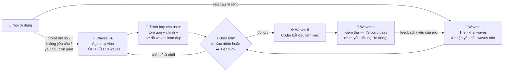
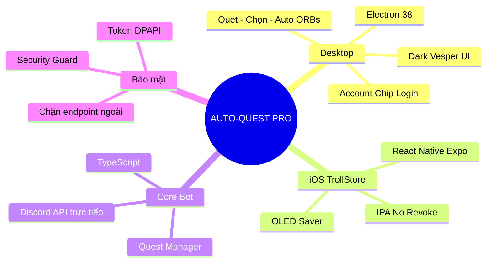
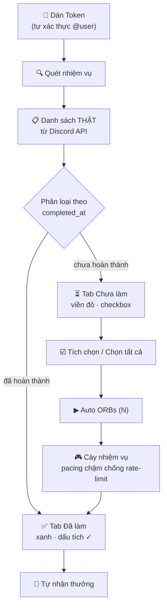

# ⚡ AUTO-QUEST PRO (Multiplatform Edition)

[](https://github.com/duyzoz/AUTO-QUEST/releases)
[](#)
[](#)
[](#-quy-tr%C3%ACnh-waves)

> ## 🤖 LƯU Ý CHO AI AGENT (BẮT BUỘC ĐỌC TRƯỚC KHI VIẾT/SỬA CODE)
> Trước khi viết/sửa code, agent **PHẢI đọc hết README này** (mục **Quy trình Waves** + **`---- Log AI Agent ----`** ở cuối). Không đọc = làm lệch kiến trúc.
> Sau mỗi phiên: ghi **1 dòng log** vào mục Log AI Agent (model thật + việc đã làm + đang dở) và **chỉ giữ đúng 3 log gần nhất** — log cũ hơn xoá khỏi README.
> Muốn hiểu thật kĩ mọi thay đổi: đọc thư mục **`.brain/`** (log đầy đủ theo ngày `YYYY-MM-DD.txt`).

> ### 🆔 BƯỚC 0 — TỰ NHẬN DIỆN MODEL CỦA CHÍNH BẠN (BẮT BUỘC)
> **Bất kỳ AI nào động vào code dự án này phải biết chính xác mình là model gì trước khi gõ dòng code đầu tiên.**
> 1. Lấy tên model từ **thông tin runtime/phiên làm việc thật của bạn** (chuỗi model id mà hệ thống đang chạy trong phiên này).
> 2. **CẤM** điền tên model của phiên trước · **CẤM** copy log cũ · **CẤM** đoán · **CẤM** để trống.
> 3. Không tự xác định được → ghi đúng `UNKNOWN-MODEL` để chủ dự án tìm ra, đừng bịa.
> 4. Ghi 1 dòng vào đầu `.brain/` log ngày đó: `MODEL CHECK: <model-id> — session <thời gian>`.

---

## 🌊 Quy Trình Waves (BẮT BUỘC)

**Waves I / I-B / II / III là các MỤC CHÍNH bắt buộc** (khung cố định). Bên trong mỗi mục chính:
- Waves con được agent **tự vibe sáng tạo** hoặc theo promt của người dùng.
- **CẤM đặt tên waves con trùng tên đề mục chính** (`Waves I`, `Waves I-B`, `Waves II`, `Waves III`). Waves con dùng **số riêng** + **tên riêng sáng tạo** (VD: `Waves 10 · Boost progress bar`, `Waves 11 · Ninja log cleanup`).
- Mỗi waves con vẫn tuân luật đánh số `0 → ∞` chỉ tăng bên dưới.

Các giai đoạn cố định: **Waves I → Waves I-B (tự vibe 10 waves, nếu cần) → Waves II → Waves III**.



| Giai đoạn | Nội dung | Ai quyết định |
|---|---|---|
| **Waves I** | Triển khai waves, tiếp nhận yêu cầu waves nhỏ từ người dùng | Người dùng + Agent |
| **Waves I-B** | Agent **tự vibe ra các waves** đóng góp cho dự án (fix lỗi, tối ưu, sửa UI/UX, thêm tính năng) — **TỐI THIỂU 10 waves** | Agent đề xuất → **user xác nhận** |
| **Waves II** | Bắt đầu làm việc (coder) — sửa code, UI/UX, logic | Agent |
| **Waves III** | Kiểm thử — `tsc` build pass, syntax check, smoke test | Agent (theo yêu cầu người dùng) |

### ✨ Waves I-B — Tự vibe ra waves (khi yêu cầu thô sơ)

**Khi nào áp dụng:**
- Người dùng chỉ promt **thô sơ**, muốn có cái gì đó **ngay lập tức**.
- Người dùng **không yêu cầu gì** cụ thể.
- Người dùng chỉ yêu cầu **đơn giản** / mơ hồ / không đủ chi tiết để bắt tay code.

**Cách làm (BẮT BUỘC):**
1. **Từ từ** — không nhảy vô code. Agent tự suy nghĩ và liệt kê **TỐI THIỂU 10 waves** có đóng góp thật cho dự án. Ví dụ nhóm waves được vibe: 🐞 fix bug · ⚡ tối ưu / performance · 🎨 sửa UI/UX · ✨ thêm tính năng · 🧹 dọn repo / tài liệu · 🔒 bảo mật · ♿ accessibility · 🧪 kiểm thử · 📦 build & release.
2. Mỗi waves vibe ra phải có: **số waves riêng** (không trùng số cũ — xem luật đánh số bên dưới), **icon**, **mô tả 1 dòng**, **mức độ ưu tiên**.
3. **Ghi ra cho user đọc** — tóm gọn **ý chính**, trình bày gọn bằng **sơ đồ waves đẹp, icon đầy đủ** (không đổ ra tường chữ).
4. **DỪNG lại ở đây** — chờ user bấm **✅ Xác nhận** hoặc **➡️ Tiếp tục** thì mới được sang **Waves II**.
5. User chưa xác nhận → **không viết code**. User chỉnh sửa / từ chối → vibe lại.

> 🧾 Mẫu trình bày cho user (agent copy cấu trúc này, tự điền nội dung theo dự án):
>
> ```mermaid
> flowchart LR
>     A["🐞 Waves 8<br/>Fix bug X"] --> B["⚡ Waves 9<br/>Tối ưu Y"]
>     B --> C["🎨 Waves 10<br/>Sửa UI/UX Z"]
>     C --> D["✨ Waves 11<br/>Tính năng W"]
>     D --> E["🧹 Waves 12<br/>Dọn repo & docs"]
> ```

**Quy tắc đánh số (BẮT BUỘC — không được vi phạm):**
- Dải số: **`0` → `∞`**, mỗi phiên edit = **1 waves mới**.
- **Chỉ TĂNG**: waves kế tiếp = **số lớn nhất đã ghi + 1**.
- **CẤM** trùng số waves · **CẤM** lùi số · **CẤM** reset về `0` · **CẤM** dùng số nhỏ hơn log gần nhất.
- Người dùng yêu cầu waves → vẫn tăng dần theo tiến độ, **không đánh lại số cũ**.
- Người dùng nhắn nhiều thay đổi trong 1 phiên → gộp vào **1 waves duy nhất** (không tách trùng số).
- Waves **tự vibe** cũng tuân luật trên: ghi trước vào kế hoạch, **chỉ tính là "đã dùng" khi user xác nhận và agent làm xong**.

### 📋 Backlog Waves I-B (đề xuất — chờ bro duyệt)

Khi bro chỉ cần "cải thiện / fix lỗi / thêm tính năng", agent vibe ra **≥10 waves** như sau (đã làm **Waves 9**, còn lại là đề xuất, chưa chạm code):

```mermaid
flowchart LR
    A["🐞 W9 ✅<br/>Fix escapeHtml<br/>(chống injection)"] --> B["✨ W10<br/>Nút mở Discord<br/>(locked IPC)"]
    B --> C["♿ W11<br/>a11y: aria-live<br/>focus rõ"]
    C --> D["📊 W12<br/>Tổng Orbs<br/>đã chọn"]
    D --> E["⚡ W13<br/>Throttle progress<br/>giảm reflow"]
    E --> F["🔒 W14<br/>Security guard<br/>chặn URL ngoài"]
    F --> G["🧹 W15<br/>Dọn console.log<br/>chuẩn hoá log level"]
    G --> H["🧪 W16<br/>Unit test<br/>escapeHtml/dedupe"]
    H --> I["📦 W17<br/>Checksum log<br/>khi build EXE"]
    I --> J["🎨 W18<br/>Empty-state<br/>hướng dẫn rõ"]
    J --> K["💾 W19<br/>Lưu pref<br/>autoScroll/loop"]
    K --> L["🔔 W20<br/>Toast cảnh báo<br/>khi token hết hạn"]
```



> 🟢 **Waves 9 đã làm xong** (bro xác nhận): `escapeHtml` đúng chuẩn · nút "↗ Discord" mở `discord.com/quests` qua IPC chỉ cho phép `discord.com` · `role="log" aria-live` cho nhật ký · hiển thị tổng Orbs của các quest đã chọn.
> ⚪ **W10–W20** là backlog đề xuất — bro bấm **✅ Xác nhận** / gõ "làm tiếp" để agent triển khai từng wave (mỗi wave = 1 số mới, không trùng).

---

## 🧠 Sơ Đồ Tư Duy Dự Án



## 🔄 Luồng Hoạt Động Chuẩn



> ⚠️ **Nguyên tắc vàng:** App **KHÔNG tự nhận nhiệm vụ** (không auto-enroll). Chỉ quét danh sách thật — người dùng tự nhận nhiệm vụ trong app Discord nếu muốn, sau đó tích chọn trong app và bấm **Auto ORBs**.

## 🗺️ Hướng Đi (Roadmap)

```mermaid
flowchart LR
    W0["Waves 0<br/>Audit repo"] --> W3["Waves 3<br/>Fix orbs + UI/UX"]
    W3 --> W4["Waves 4<br/>Dữ liệu thật<br/>bỏ auto-enroll"]
    W4 --> W5["Waves 5<br/>Chuẩn hoá log<br/>3 phiên gần nhất"]
    W5 --> W6["Waves 6<br/>Luật waves<br/>không trùng số"]
    W6 --> W7["Waves 7<br/>Dev lại<br/>công cụ build EXE"]
    W7 --> W8["Waves 8<br/>README Waves I-B<br/>+ model đúng"]
    W8 --> W9["Waves 9<br/>Cải thiện:<br/>fix escapeHtml · mở Discord · a11y"]
    W9 --> W10["Waves 10 · Smooth Progress<br/>20/10: throttle render,<br/>pref autoScroll, cảnh báo token"]
    W10 --> W11["Waves 11 · Discord Dress-Up<br/>20/10: profile Discord thật,<br/>nav 3 trang, xoá monetize"]
    W11 --> W12["Waves 12 · Left Rail Rebuild<br/>20/10: bố cục rail Discord,<br/>user panel + logout, ORB thật"]
    W12 --> W13["Waves 13 · Kasumu Reskin<br/>20/10: bê UI kasumu-ui,<br/>diệt 100% emoji, font Inter"]
    W13 --> W14["Waves 14 · Profile & Balance<br/>20/10: hero profile giữa trang,<br/>ORB balance đáy sidebar kiểu kasumu"]
    W14 --> B["⏸ Build EXE<br/>(chờ lệnh)"]
    B --> P["⏸ Push GitHub<br/>(chờ lệnh)"]
```



**Sổ waves đã dùng (agent mới KHÔNG được đánh lại số trong bảng này):**

| Waves | Nội dung | Trạng thái |
|---|---|---|
| **0** | Audit repo — 13 lỗi, đề xuất waves | ✅ Xong |
| **3** | Fix orbs cộng ảo + UI/UX + dọn repo | ✅ Xong |
| **4** | Dữ liệu thật + bỏ auto-enroll | ✅ Xong |
| **5** | Chuẩn hoá log — giữ 3 phiên | ✅ Xong |
| **6** | Luật waves không trùng số | ✅ Xong |
| **7** | Dev lại công cụ build EXE | ✅ Xong |
| **8** | README: Waves I-B (tự vibe 10 waves) + sửa model log | ✅ Xong |
| **9** | Cải thiện/fix/feature bundle (escapeHtml, mở Discord, a11y, tổng Orbs) | ✅ Xong |
| **10** | Smooth Progress — throttle render defer + pref autoScroll + cảnh báo token hết hạn | ✅ Xong |
| **11** | Discord Dress-Up — đại cải tổ UI theo Discord web (profile banner/avatar/decoration/clan, nav 3 trang, xoá monetize) | ✅ Xong |
| **12** | Left Rail Rebuild — bố cục rail server-icon chuẩn Discord: user panel dưới-trái (avatar + tên + icon Đăng xuất), popout profile (banner + decoration + clan + **SỐ ORB KHẢ DỤNG trích THẬT** từ claim trên account), nav từ rail | ✅ Xong |
| **13** | Kasumu Reskin — bê nguyên design system kasumu-ui (sidebar 256px, hero card, stat tint-ring, Inter + JetBrains Mono local) + **diệt 100% emoji** toàn app, thay bằng SVG stroke | ✅ Xong |
| **14** | Profile & Balance — hero profile Discord thật giữa trang khi dán token (banner + avatar + decoration + clan) + **Số dư khả dụng** chuyển ra khối đáy sidebar kiểu kasumu (font-mono emerald như tiền) + trích xuất Orb thật NGAY lúc đăng nhập qua `orbs:fetch` (không cần chạy bot) | ✅ Xong |
| **15+** | Backlog Waves I-B (đề xuất: unit test, checksum, empty-state...) | 🔜 Kế tiếp |

> 👉 Phiên edit tiếp theo **bắt buộc** là **`Waves 15`**, sau đó `16`, `17`… **Waves 1–2 không tồn tại** trong dự án này → **cấm** dùng lại.

---

## 🎨 Tính Năng

| Tính năng | Mô tả |
|-----------|-------|
| **Dark Strong Vesper** | Nền OLED `#000000`, bề mặt than/nâu `#100d14`, điểm nhấn hổ phách `#ff9e64`. |
| **Bố cục Discord Left-Rail** | Rail icon trái (Auto Quest · Cài đặt · Giới thiệu) + user panel góc dưới-trái: avatar + tên + icon **Đăng xuất**; bấm mở popout profile Discord (banner · avatar decoration · clan badge); **hero profile Discord thật** giữa trang Auto Quest khi đã đăng nhập. |
| **SỐ DƯ KHẢ DỤNG (kasumu style)** | Khối riêng đáy sidebar (sát đáy-trái) kiểu stat card kasumu: label uppercase + icon coins emerald + **số font-mono emerald xanh như tiền**. Trích THẬT ngay lúc đăng nhập (`GET /quests/@me`): chỉ đếm quest đã hoàn thành **và đã claim**; orb done-chưa-claim hiển thị line phụ "chờ nhận thưởng". |
| **Account Chip Login** | Dán token → tự xác thực `discord.com/api` → hiện `@username` + avatar thật từ Discord CDN. |
| **Quét trước — Chạy sau** | **Quét nhiệm vụ** lấy danh sách thật → tab "⏳ Chưa làm" (viền đỏ, checkbox từng nhiệm vụ + **Chọn tất cả**) → **Auto ORBs (N)** chạy đúng nhiệm vụ đã chọn. |
| **Không tự nhận nhiệm vụ** | App tuyệt đối không auto-enroll. Nhiệm vụ "Chưa nhận" hiển thị đúng trạng thái Discord, checkbox khoá cho tới khi bạn nhận trong app Discord. |
| **Số liệu chuẩn 100%** | "Đã làm" chỉ chứa nhiệm vụ Discord xác nhận `completed_at`; "Chưa làm" chỉ chứa nhiệm vụ còn hiệu lực (đã bắt đầu, chưa hết hạn, không preview). |
| **Orbs chuẩn** | Mỗi nhiệm vụ cộng Orbs đúng **một lần** (dedupe theo quest id), không cộng ảo khi quét lại. |
| **Bảo mật 100%** | Chỉ kết nối `discord.com` — chặn đứng mọi webhook/endpoint ngoài. Token mã hóa Windows DPAPI. |
| **Treo AFK Loop** | Tự đếm ngược chu kỳ 15/30/45/60 phút để quét lại nhiệm vụ mới. |
| **🌙 OLED Saver (iOS)** | Giữ app hoạt động qua đêm với 0% hao pin. |

---

## 📥 TẢI VỀ CÀI ĐẶT

### 🖥️ Windows Desktop
- Vào **[Releases](https://github.com/duyzoz/AUTO-QUEST/releases)** → tải **`AUTO-QUEST.exe`**.
- Mở file, dán token, bấm **Quét nhiệm vụ** → chọn → **Auto ORBs**.

### 📱 iPhone (TrollStore)
- Tải **`AUTO-QUEST-PRO-TrollStore.ipa`** từ Releases/Actions.
- Mở bằng **TrollStore** → **Install** (chạy vĩnh viễn, không hết hạn chứng chỉ).

---

## 🔑 HƯỚNG DẪN LẤY TOKEN DISCORD

### Cách 1: Máy tính (Console)
1. Mở Discord (Web/App), bấm `F12` → tab **Console**.
2. Nếu Discord chặn dán: gõ `allow pasting` rồi Enter.
3. Dán đoạn mã sau rồi Enter:

```javascript
window.webpackChunkdiscord_app.push([
	[Symbol()],
	{},
	req => {
		if (!req.c) return;
		for (let m of Object.values(req.c)) {
			try {
				if (!m.exports || m.exports === window) continue;
				if (m.exports?.getToken) return copy(m.exports.getToken());
				for (let ex in m.exports) {
					if (m.exports?.[ex]?.getToken && m.exports[ex][Symbol.toStringTag] !== 'IntlMessagesProxy') return copy(m.exports[ex].getToken());
				}
			} catch {}
		}
	},
]);
window.webpackChunkdiscord_app.pop();
console.log('%c🎉 ĐÃ COPY TOKEN DISCORD THÀNH CÔNG! 🎉', 'color: #10b981; font-size: 22px; font-weight: bold; background: #000; padding: 10px; border-radius: 8px;');
```

4. Quay lại app bấm **Dán** → chip góc phải tự hiện `@username` → **Lưu**.

### Cách 2: iPhone (Safari)
1. Safari → `discord.com/app`, đăng nhập.
2. Trong app bấm **COPY SCRIPT LẤY TOKEN**.
3. Thanh địa chỉ Safari: gõ `javascript:` rồi dán script, Enter.
4. Quay lại app bấm **Dán** → **Lưu Token**.

---

## 📁 Cấu Trúc Repo

```
AUTO-QUEST-main/
├── bot.ts                  # Entry point bot (compile → electron/bot/)
├── src/                    # Core logic TypeScript
│   ├── client.ts           # Discord REST + Gateway
│   ├── questManager.ts     # Quản lý & thực thi nhiệm vụ
│   ├── security.ts         # Chặn endpoint ngoài
│   └── ...
├── electron/               # Desktop app
│   ├── main.js             # Main process + IPC
│   ├── preload.js          # Bridge an toàn
│   └── renderer/           # UI (index.html, renderer.js, styles.css)
├── mobile/                 # iOS (React Native) — KHÔNG ĐỤNG
├── tools/                  # Công cụ build (build.js EXE, upload IPA)
├── build-release/         # Script + output build/release
│   ├── build-ipa/         # Script build IPA iOS
│   └── exe/               # Output EXE portable (gitignore)
├── docs/                  # Hướng dẫn sử dụng
├── .brain/                # Log AI Agent theo ngày (YYYY-MM-DD.txt)
└── README.md
```

---

## 🧪 Dev Mode (xem giao diện trước khi build)

```bash
npm install        # lần đầu
npm run dev        # build bot TS + mở Electron
```

## 📦 Công Cụ Build EXE

```bash
npm run build:check   # DRY-RUN: kiểm tra môi trường + in kế hoạch, KHÔNG tạo EXE
npm run build         # build thật (chỉ khi có lệnh)
```

| Lệnh | Tác dụng |
|---|---|
| `npm run build:check` | Kiểm tra `node_modules`, icon, `package.json`, bot core đã compile chưa. In kế hoạch build. **Không tạo file EXE.** |
| `npm run build` | `tsc` → `electron-builder --win portable` → xác minh artifact + sha256. Kết quả nằm gọn trong **`build-release/exe/`**. |
| `node tools/build.js --skip-tsc` | Bỏ qua biên dịch TS (dùng lại `electron/bot/` cũ). |

Output luôn về `build-release/exe/` (đã `.gitignore`) — không còn copy EXE ra gốc repo nữa.

> ⚠️ **Không tự ý chạy `npm run build`** nếu chủ dự án chưa ra lệnh — riêng phiên Waves 7 chỉ chỉnh công cụ, **chưa build**.

---

## 📜 Giấy phép & Miễn trừ trách nhiệm
Dự án phục vụ mục đích học tập và tối ưu trải nghiệm cá nhân. Không liên kết chính thức với Discord Inc.

---

## ---- Log AI Agent ----

> **Luật:** chỉ giữ **đúng 3 log gần nhất** (mới nhất trên cùng). Log cũ hơn xoá khỏi README. Muốn hiểu thật kĩ mọi thay đổi → đọc **`.brain/`**. Mỗi dòng ghi **đúng model của phiên đó**.

- **[2026-10-20 ~23:55 · step-5-preview · Waves 14 — Profile & Balance (hero profile giữa trang + ORB đáy sidebar)]** Bro duyệt layout nhưng chặn 2 lỗi: (1) dán token xong giữa trang không có profile; (2) SỐ ORB KHẢ DỤNG sai chỗ + chưa extract được. Làm: **`#heroProfile`** — hero card kasumu giữa trang Auto Quest hiện khi đăng nhập: **banner 116px** (CDN → accent gradient → default), **avatar 92px** đè lên banner (border card, decoration lớp phủ CDN), display name 1.45rem + **clan badge + tag**, username mono; `heroGuest` tự ẩn. **`#sideBalance`** — khối "Số dư khả dụng" đáy sidebar (sát đáy-trái) y hệt stat card kasumu: label uppercase + icon coins emerald + **số `font-mono` emerald `#00d294` 1.7rem tabular như tiền** + dòng phụ pending; live → viền emerald. **Trích xuất THẬT lúc login**: IPC mới `orbs:fetch` (`GET /quests/@me` với token user, `auth:check` trả kèm `token`) — `balance` = quest completed + `claimed_at`, `pendingClaim` = done chưa claim; **không cần chạy bot**, dán token là thấy số dư; bot chạy tiếp vẫn push `orbs:balance` cập nhật cùng khối. Bỏ khung orbs cũ trong pop profile. Dọn 2 emoji sót trong `main.js` log (boot/stop). Pass: node --check ×3, DOM-id 72/72, emoji scan = 0. Không build EXE, không push.
- **[2026-10-20 ~23:20 · step-5-preview · Waves 13 — Kasumu Reskin (bê UI kasumu-ui + diệt emoji)]** Bro ra lệnh: bỏ bản cũ, vào `kasumu-ui/` bê NGUYÊN UI/UX qua source, cấm đổi bản chất Auto Quest, và **CẤM TUYỆT ĐỐI emoji icon mặc định** (xấu). Làm: **design tokens 1:1 từ kasumu** (ink-950 `#05060b` / ink-900 sidebar / ink-800 hover, fg `#f3f5fa`, line `#ffffff14`, brand violet `#8b5cf6`, radius-field 0.75rem/card 1.125rem, ease-out-quint) — copy 13 file woff2 **Inter + JetBrains Mono local** (fonts.css 31 @font-face unicode-range, không CDN). **Layout kasumu**: sidebar 256px fixed (brand + user panel Discord + nav "Menu" có thanh trắng 3px bên trái), main max-w-6xl: **hero card** gradient-text + CTA, **3 stat card** ring tint (--tint emerald/violet/cyan + icon góc phải), quest card tab + chip, console card. **Icon**: thay TOÀN BỘ emoji bằng SVG stroke kiểu lucide (nav, stat, nút, empty-state, ghost-btn) — scan 11 file = **0 emoji** (renderer.js, index.html, bot.ts, questManager.ts + compiled bot.js/questManager.js). Toggle token đổi sang SVG + span text. Mobile: topbar + drawer trượt có overlay. Window `#05060b`, title "AUTO QUEST". Logic scan/run/claim/orbs:balance KHÔNG đổi. Pass: tsc + compile, node --check ×4, DOM-id 62/62. Không build EXE, không push.
- **[2026-10-20 ~23:30 · step-5-preview · Waves 12 — Left Rail Rebuild (sửa bố cục theo kasumu)]** Bro chê bố cục Waves 11 sai → dựng lại **y hệt Discord web**: **left rail 88px** icon vuông bo góc (16px idle → 14px active, pill trắng chỉ-vị-trí), **user panel đáy-trái** — hàng avatar + tên + **icon ĐĂNG XUẤT** (thay mic/headset/settings cũ, hover đỏ), bấm mở **popout profile**: banner CDN → accent gradient, avatar + decoration lớp phủ, clan badge + tag, **khung "SỐ ORB KHẢ DỤNG" màu hổ phách `#ffb85c` + icon orb SVG gradient**. **ORB THẬT không bịa**: `bot.ts` quét xong tính `orbBalance` = tổng orb quest `isCompleted()` **và** `hasClaimedRewards()` (`user_status.claimed_at` từ Discord API); quest done chưa claim gộp vào `pendingClaim` hiển thị "+N chờ nhận"; event mới `orbs:balance` → renderer cập nhật panel + stat card; **claim xong đợt cày tự refresh số dư**. Logout xoá token (DPAPI) → về guest. Pass: node --check ×3, DOM-id scan 58/58, tsc pass, compile bot.js. Không build EXE, không push.
