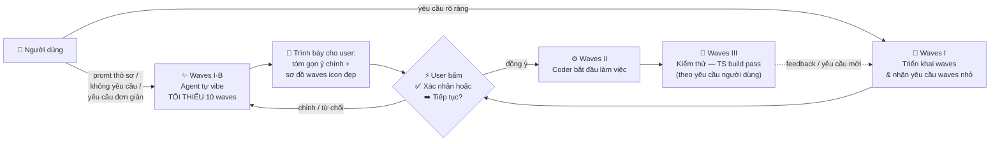
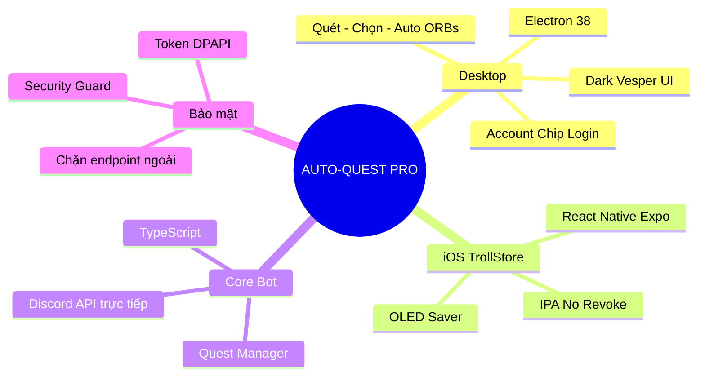
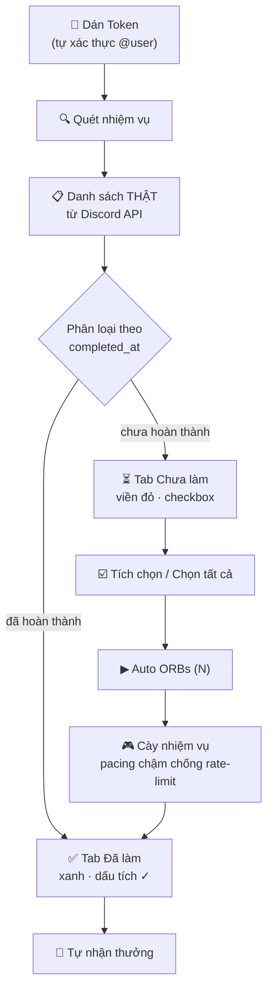

# ⚡ AUTO-QUEST PRO (Multiplatform Edition)

[](https://github.com/duyzoz/AUTO-QUEST/releases)
[](#)
[](#)
[](#-quy-tr%C3%ACnh-waves)

> ## 🤖 LƯU Ý CHO AI AGENT (BẮT BUỘC ĐỌC TRƯỚC KHI VIẾT/SỬA CODE)
> Trước khi viết/sửa code, agent **PHẢI đọc hết README này** (mục **Quy trình Waves** + **`---- Log AI Agent ----`** ở cuối). Không đọc = làm lệch kiến trúc.
> Sau mỗi phiên: ghi **1 dòng log** vào mục Log AI Agent (model thật + việc đã làm + đang dở) và **chỉ giữ đúng 3 log gần nhất** — log cũ hơn xoá khỏi README.
> Muốn hiểu thật kĩ mọi thay đổi: đọc thư mục **`.brain/`** (log đầy đủ theo ngày `YYYY-MM-DD.txt`).

> ### 🆔 BƯỚC 0 — TỰ NHẬN DIỆN MODEL CỦA CHÍNH BẠN (BẮT BUỘC)
> **Bất kỳ AI nào động vào code dự án này phải biết chính xác mình là model gì trước khi gõ dòng code đầu tiên.**
> 1. Lấy tên model từ **thông tin runtime/phiên làm việc thật của bạn** (chuỗi model id mà hệ thống đang chạy trong phiên này).
> 2. **CẤM** điền tên model của phiên trước · **CẤM** copy log cũ · **CẤM** đoán · **CẤM** để trống.
> 3. Không tự xác định được → ghi đúng `UNKNOWN-MODEL` để chủ dự án tìm ra, đừng bịa.
> 4. Ghi 1 dòng vào đầu `.brain/` log ngày đó: `MODEL CHECK: <model-id> — session <thời gian>`.

---

## 🌊 Quy Trình Waves (BẮT BUỘC)

Các giai đoạn cố định: **Waves I → Waves I-B (tự vibe 10 waves, nếu cần) → Waves II → Waves III**.



| Giai đoạn | Nội dung | Ai quyết định |
|---|---|---|
| **Waves I** | Triển khai waves, tiếp nhận yêu cầu waves nhỏ từ người dùng | Người dùng + Agent |
| **Waves I-B** | Agent **tự vibe ra các waves** đóng góp cho dự án (fix lỗi, tối ưu, sửa UI/UX, thêm tính năng) — **TỐI THIỂU 10 waves** | Agent đề xuất → **user xác nhận** |
| **Waves II** | Bắt đầu làm việc (coder) — sửa code, UI/UX, logic | Agent |
| **Waves III** | Kiểm thử — `tsc` build pass, syntax check, smoke test | Agent (theo yêu cầu người dùng) |

### ✨ Waves I-B — Tự vibe ra waves (khi yêu cầu thô sơ)

**Khi nào áp dụng:**
- Người dùng chỉ promt **thô sơ**, muốn có cái gì đó **ngay lập tức**.
- Người dùng **không yêu cầu gì** cụ thể.
- Người dùng chỉ yêu cầu **đơn giản** / mơ hồ / không đủ chi tiết để bắt tay code.

**Cách làm (BẮT BUỘC):**
1. **Từ từ** — không nhảy vô code. Agent tự suy nghĩ và liệt kê **TỐI THIỂU 10 waves** có đóng góp thật cho dự án. Ví dụ nhóm waves được vibe: 🐞 fix bug · ⚡ tối ưu / performance · 🎨 sửa UI/UX · ✨ thêm tính năng · 🧹 dọn repo / tài liệu · 🔒 bảo mật · ♿ accessibility · 🧪 kiểm thử · 📦 build & release.
2. Mỗi waves vibe ra phải có: **số waves riêng** (không trùng số cũ — xem luật đánh số bên dưới), **icon**, **mô tả 1 dòng**, **mức độ ưu tiên**.
3. **Ghi ra cho user đọc** — tóm gọn **ý chính**, trình bày gọn bằng **sơ đồ waves đẹp, icon đầy đủ** (không đổ ra tường chữ).
4. **DỪNG lại ở đây** — chờ user bấm **✅ Xác nhận** hoặc **➡️ Tiếp tục** thì mới được sang **Waves II**.
5. User chưa xác nhận → **không viết code**. User chỉnh sửa / từ chối → vibe lại.

> 🧾 Mẫu trình bày cho user (agent copy cấu trúc này, tự điền nội dung theo dự án):
>
> ```mermaid
> flowchart LR
>     A["🐞 Waves 8<br/>Fix bug X"] --> B["⚡ Waves 9<br/>Tối ưu Y"]
>     B --> C["🎨 Waves 10<br/>Sửa UI/UX Z"]
>     C --> D["✨ Waves 11<br/>Tính năng W"]
>     D --> E["🧹 Waves 12<br/>Dọn repo & docs"]
> ```

**Quy tắc đánh số (BẮT BUỘC — không được vi phạm):**
- Dải số: **`0` → `∞`**, mỗi phiên edit = **1 waves mới**.
- **Chỉ TĂNG**: waves kế tiếp = **số lớn nhất đã ghi + 1**.
- **CẤM** trùng số waves · **CẤM** lùi số · **CẤM** reset về `0` · **CẤM** dùng số nhỏ hơn log gần nhất.
- Người dùng yêu cầu waves → vẫn tăng dần theo tiến độ, **không đánh lại số cũ**.
- Người dùng nhắn nhiều thay đổi trong 1 phiên → gộp vào **1 waves duy nhất** (không tách trùng số).
- Waves **tự vibe** cũng tuân luật trên: ghi trước vào kế hoạch, **chỉ tính là "đã dùng" khi user xác nhận và agent làm xong**.

---

## 🧠 Sơ Đồ Tư Duy Dự Án



## 🔄 Luồng Hoạt Động Chuẩn



> ⚠️ **Nguyên tắc vàng:** App **KHÔNG tự nhận nhiệm vụ** (không auto-enroll). Chỉ quét danh sách thật — người dùng tự nhận nhiệm vụ trong app Discord nếu muốn, sau đó tích chọn trong app và bấm **Auto ORBs**.

## 🗺️ Hướng Đi (Roadmap)

```mermaid
flowchart LR
    W0["Waves 0<br/>Audit repo"] --> W3["Waves 3<br/>Fix orbs + UI/UX"]
    W3 --> W4["Waves 4<br/>Dữ liệu thật<br/>bỏ auto-enroll"]
    W4 --> W5["Waves 5<br/>Chuẩn hoá log<br/>3 phiên gần nhất"]
    W5 --> W6["Waves 6<br/>Luật waves<br/>không trùng số"]
    W6 --> W7["Waves 7<br/>Dev lại<br/>công cụ build EXE"]
    W7 --> W8["Waves 8<br/>README Waves I-B<br/>+ model đúng"]
    W8 --> W9["Waves 9+<br/>Phiên edit kế tiếp<br/>(tự tăng)"]
    W9 --> B["⏸ Build EXE<br/>(chờ lệnh)"]
    B --> P["⏸ Push GitHub<br/>(chờ lệnh)"]
```



**Sổ waves đã dùng (agent mới KHÔNG được đánh lại số trong bảng này):**

| Waves | Nội dung | Trạng thái |
|---|---|---|
| **0** | Audit repo — 13 lỗi, đề xuất waves | ✅ Xong |
| **3** | Fix orbs cộng ảo + UI/UX + dọn repo | ✅ Xong |
| **4** | Dữ liệu thật + bỏ auto-enroll | ✅ Xong |
| **5** | Chuẩn hoá log — giữ 3 phiên | ✅ Xong |
| **6** | Luật waves không trùng số | ✅ Xong |
| **7** | Dev lại công cụ build EXE | ✅ Xong |
| **8** | README: Waves I-B (tự vibe 10 waves) + sửa model log | ✅ Xong |
| **9+** | Phiên edit kế tiếp | 🔜 Kế tiếp |

> 👉 Phiên edit tiếp theo **bắt buộc** là **`Waves 9`**, sau đó `10`, `11`… **Waves 1–2 không tồn tại** trong dự án này → **cấm** dùng lại.

---

## 🎨 Tính Năng

| Tính năng | Mô tả |
|-----------|-------|
| **Dark Strong Vesper** | Nền OLED `#000000`, bề mặt than/nâu `#100d14`, điểm nhấn hổ phách `#ff9e64`. |
| **Account Chip Login** | Dán token → tự xác thực `discord.com/api` → hiện `@username` + avatar thật từ Discord CDN. |
| **Quét trước — Chạy sau** | **Quét nhiệm vụ** lấy danh sách thật → tab "⏳ Chưa làm" (viền đỏ, checkbox từng nhiệm vụ + **Chọn tất cả**) → **Auto ORBs (N)** chạy đúng nhiệm vụ đã chọn. |
| **Không tự nhận nhiệm vụ** | App tuyệt đối không auto-enroll. Nhiệm vụ "Chưa nhận" hiển thị đúng trạng thái Discord, checkbox khoá cho tới khi bạn nhận trong app Discord. |
| **Số liệu chuẩn 100%** | "Đã làm" chỉ chứa nhiệm vụ Discord xác nhận `completed_at`; "Chưa làm" chỉ chứa nhiệm vụ còn hiệu lực (đã bắt đầu, chưa hết hạn, không preview). |
| **Orbs chuẩn** | Mỗi nhiệm vụ cộng Orbs đúng **một lần** (dedupe theo quest id), không cộng ảo khi quét lại. |
| **Bảo mật 100%** | Chỉ kết nối `discord.com` — chặn đứng mọi webhook/endpoint ngoài. Token mã hóa Windows DPAPI. |
| **Treo AFK Loop** | Tự đếm ngược chu kỳ 15/30/45/60 phút để quét lại nhiệm vụ mới. |
| **🌙 OLED Saver (iOS)** | Giữ app hoạt động qua đêm với 0% hao pin. |

---

## 📥 TẢI VỀ CÀI ĐẶT

### 🖥️ Windows Desktop
- Vào **[Releases](https://github.com/duyzoz/AUTO-QUEST/releases)** → tải **`AUTO-QUEST.exe`**.
- Mở file, dán token, bấm **Quét nhiệm vụ** → chọn → **Auto ORBs**.

### 📱 iPhone (TrollStore)
- Tải **`AUTO-QUEST-PRO-TrollStore.ipa`** từ Releases/Actions.
- Mở bằng **TrollStore** → **Install** (chạy vĩnh viễn, không hết hạn chứng chỉ).

---

## 🔑 HƯỚNG DẪN LẤY TOKEN DISCORD

### Cách 1: Máy tính (Console)
1. Mở Discord (Web/App), bấm `F12` → tab **Console**.
2. Nếu Discord chặn dán: gõ `allow pasting` rồi Enter.
3. Dán đoạn mã sau rồi Enter:

```javascript
window.webpackChunkdiscord_app.push([
	[Symbol()],
	{},
	req => {
		if (!req.c) return;
		for (let m of Object.values(req.c)) {
			try {
				if (!m.exports || m.exports === window) continue;
				if (m.exports?.getToken) return copy(m.exports.getToken());
				for (let ex in m.exports) {
					if (m.exports?.[ex]?.getToken && m.exports[ex][Symbol.toStringTag] !== 'IntlMessagesProxy') return copy(m.exports[ex].getToken());
				}
			} catch {}
		}
	},
]);
window.webpackChunkdiscord_app.pop();
console.log('%c🎉 ĐÃ COPY TOKEN DISCORD THÀNH CÔNG! 🎉', 'color: #10b981; font-size: 22px; font-weight: bold; background: #000; padding: 10px; border-radius: 8px;');
```

4. Quay lại app bấm **Dán** → chip góc phải tự hiện `@username` → **Lưu**.

### Cách 2: iPhone (Safari)
1. Safari → `discord.com/app`, đăng nhập.
2. Trong app bấm **COPY SCRIPT LẤY TOKEN**.
3. Thanh địa chỉ Safari: gõ `javascript:` rồi dán script, Enter.
4. Quay lại app bấm **Dán** → **Lưu Token**.

---

## 📁 Cấu Trúc Repo

```
AUTO-QUEST-main/
├── bot.ts                  # Entry point bot (compile → electron/bot/)
├── src/                    # Core logic TypeScript
│   ├── client.ts           # Discord REST + Gateway
│   ├── questManager.ts     # Quản lý & thực thi nhiệm vụ
│   ├── security.ts         # Chặn endpoint ngoài
│   └── ...
├── electron/               # Desktop app
│   ├── main.js             # Main process + IPC
│   ├── preload.js          # Bridge an toàn
│   └── renderer/           # UI (index.html, renderer.js, styles.css)
├── mobile/                 # iOS (React Native) — KHÔNG ĐỤNG
├── tools/                  # Công cụ build (build.js EXE, upload IPA)
├── build-release/         # Script + output build/release
│   ├── build-ipa/         # Script build IPA iOS
│   └── exe/               # Output EXE portable (gitignore)
├── docs/                  # Hướng dẫn sử dụng
├── .brain/                # Log AI Agent theo ngày (YYYY-MM-DD.txt)
└── README.md
```

---

## 🧪 Dev Mode (xem giao diện trước khi build)

```bash
npm install        # lần đầu
npm run dev        # build bot TS + mở Electron
```

## 📦 Công Cụ Build EXE

```bash
npm run build:check   # DRY-RUN: kiểm tra môi trường + in kế hoạch, KHÔNG tạo EXE
npm run build         # build thật (chỉ khi có lệnh)
```

| Lệnh | Tác dụng |
|---|---|
| `npm run build:check` | Kiểm tra `node_modules`, icon, `package.json`, bot core đã compile chưa. In kế hoạch build. **Không tạo file EXE.** |
| `npm run build` | `tsc` → `electron-builder --win portable` → xác minh artifact + sha256. Kết quả nằm gọn trong **`build-release/exe/`**. |
| `node tools/build.js --skip-tsc` | Bỏ qua biên dịch TS (dùng lại `electron/bot/` cũ). |

Output luôn về `build-release/exe/` (đã `.gitignore`) — không còn copy EXE ra gốc repo nữa.

> ⚠️ **Không tự ý chạy `npm run build`** nếu chủ dự án chưa ra lệnh — riêng phiên Waves 7 chỉ chỉnh công cụ, **chưa build**.

---

## 📜 Giấy phép & Miễn trừ trách nhiệm
Dự án phục vụ mục đích học tập và tối ưu trải nghiệm cá nhân. Không liên kết chính thức với Discord Inc.

---

## ---- Log AI Agent ----

> **Luật:** chỉ giữ **đúng 3 log gần nhất** (mới nhất trên cùng). Log cũ hơn xoá khỏi README. Muốn hiểu thật kĩ mọi thay đổi → đọc **`.brain/`**. Mỗi dòng ghi **đúng model của phiên đó**.

- **[2026-10-19 ~20:25 · step-5-preview · Waves 8 — README Waves I-B + sửa model log]** Thêm **Waves I-B**: khi user chỉ promt thô sơ / không yêu cầu / yêu cầu đơn giản → agent **tự vibe TỐI THIỂU 10 waves** đóng góp thật (fix bug · tối ưu · UI/UX · thêm tính năng · dọn repo · bảo mật · a11y · test · build), trình bày gọn bằng sơ đồ Mermaid icon đẹp, **dừng chờ user bấm ✅ Xác nhận / ➡️ Tiếp tục** mới sang Waves II — chưa xác nhận thì không viết code. **Sửa model sai trong log:** `deepseek-v4.1-flash` (và `GLM (Z.ai)` trước đó) → **`step-5-preview`** đúng model thật; thêm **BƯỚC 0 — Tự nhận diện model** + mục `MODEL CHECK` trong `.brain/`.
- **[2026-10-19 ~20:05 · step-5-preview · Waves 7 — Dev lại công cụ build EXE (chưa build)]** Viết mới `tools/build.js`: pre-flight (node_modules/icon/package.json/bot.js), dry-run `--check`, `--skip-tsc`, dọn output trước khi build, verify artifact + kích thước + sha256, báo lỗi rõ ràng, không còn copy EXE ra gốc repo. `package.json`: output → `build-release/exe/`, tên file `AUTO-QUEST-${version}-portable.exe`, `executableName`, `requestedExecutionLevel: asInvoker`, `forceCodeSigning: false`; thêm script `build:check`. `.gitignore`: bỏ qua `build-release/exe/`. README: thêm mục **Công Cụ Build EXE** + cập nhật cấu trúc repo, Roadmap, sổ waves.
- **[2026-10-19 ~20:00 · step-5-preview · Waves 6 — Luật waves không trùng số]** Sửa quy tắc đánh số: chỉ tăng (`max + 1`), cấm trùng / cấm lùi / cấm reset `0`. Đánh lại số log cho đúng thứ tự **4 → 5 → 6** (trước đó 2 dòng cùng ghi "Waves 4"), cập nhật badge, sơ đồ Roadmap và thêm bảng **"Sổ waves đã dùng"** để agent mới không đánh lại số cũ. Không đụng code app, không build EXE, không push.
