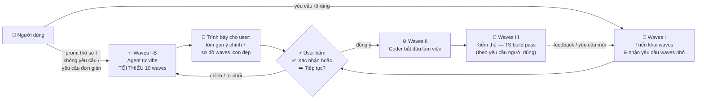
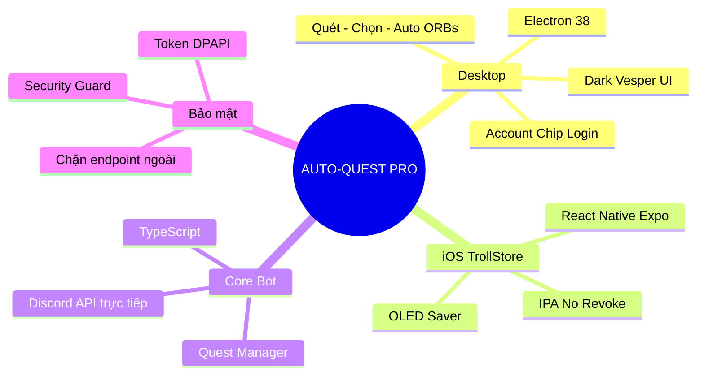
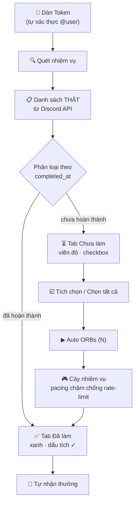
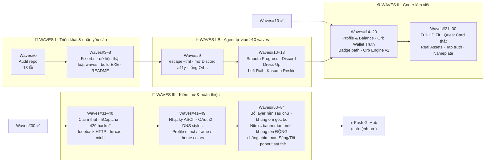

# ⚡ AUTO-QUEST PRO (Multiplatform Edition)


> ## 🤖 LƯU Ý CHO AI AGENT (BẮT BUỘC ĐỌC TRƯỚC KHI VIẾT/SỬA CODE)
>
> Trước khi viết/sửa code, agent **PHẢI đọc hết README này** (mục **Quy trình Waves** + **`---- Log AI Agent ----`** ở cuối). Không đọc = làm lệch kiến trúc.  
> Sau mỗi phiên: ghi **1 dòng log** vào mục Log AI Agent (model thật + việc đã làm + đang dở) và **chỉ giữ đúng 3 log gần nhất** — log cũ hơn xoá khỏi README.  
> Muốn hiểu thật kĩ mọi thay đổi: đọc thư mục **`.brain/`** (log đầy đủ theo ngày `YYYY-MM-DD.txt`).

> ### 🆔 BƯỚC 0 — TỰ NHẬN DIỆN MODEL CỦA CHÍNH BẠN (BẮT BUỘC)
>
> **Bất kỳ AI nào động vào code dự án này phải biết chính xác mình là model gì trước khi gõ dòng code đầu tiên.**
>
> 1. Lấy tên model từ **thông tin runtime/phiên làm việc thật của bạn** (chuỗi model id mà hệ thống đang chạy trong phiên này).
> 2. **CẤM** điền tên model của phiên trước · **CẤM** copy log cũ · **CẤM** đoán · **CẤM** để trống.
> 3. Không tự xác định được → ghi đúng `UNKNOWN-MODEL` để chủ dự án tìm ra, đừng bịa.
> 4. Ghi 1 dòng vào đầu `.brain/` log ngày đó: `MODEL CHECK: <model-id> — session <thời gian>`.

---

## 🌊 Quy Trình Waves (BẮT BUỘC)

**Waves I / I-B / II / III là các MỤC CHÍNH bắt buộc** (khung cố định). Bên trong mỗi mục chính:

- Waves con được agent **tự vibe sáng tạo** hoặc theo promt của người dùng.
- **CẤM đặt tên waves con trùng tên đề mục chính** (`Waves I`, `Waves I-B`, `Waves II`, `Waves III`). Waves con dùng **số riêng** + **tên riêng sáng tạo** (VD: `Waves#10 · Boost progress bar`, `Waves#11 · Ninja log cleanup`).
- Mỗi waves con vẫn tuân luật đánh số `#0 → ∞` chỉ tăng bên dưới.

Các giai đoạn cố định: **Waves I → Waves I-B (tự vibe 10 waves, nếu cần) → Waves II → Waves III**.



| Giai đoạn     | Nội dung                                                                                                                | Ai quyết định                     |
| ------------- | ----------------------------------------------------------------------------------------------------------------------- | --------------------------------- |
| **Waves I**   | Triển khai waves, tiếp nhận yêu cầu waves nhỏ từ người dùng                                                             | Người dùng + Agent                |
| **Waves I-B** | Agent **tự vibe ra các waves** đóng góp cho dự án (fix lỗi, tối ưu, sửa UI/UX, thêm tính năng) — **TỐI THIỂU 10 waves** | Agent đề xuất → **user xác nhận** |
| **Waves II**  | Bắt đầu làm việc (coder) — sửa code, UI/UX, logic                                                                       | Agent                             |
| **Waves III** | Kiểm thử — `tsc` build pass, syntax check, smoke test                                                                   | Agent (theo yêu cầu người dùng)   |

### ✨ Waves I-B — Tự vibe ra waves (khi yêu cầu thô sơ)

**Khi nào áp dụng:**

- Người dùng chỉ promt **thô sơ**, muốn có cái gì đó **ngay lập tức**.
- Người dùng **không yêu cầu gì** cụ thể.
- Người dùng chỉ yêu cầu **đơn giản** / mơ hồ / không đủ chi tiết để bắt tay code.

**Cách làm (BẮT BUỘC):**

1. **Từ từ** — không nhảy vô code. Agent tự suy nghĩ và liệt kê **TỐI THIỂU 10 waves** có đóng góp thật cho dự án. Ví dụ nhóm waves được vibe: 🐞 fix bug · ⚡ tối ưu / performance · 🎨 sửa UI/UX · ✨ thêm tính năng · 🧹 dọn repo / tài liệu · 🔒 bảo mật · ♿ accessibility · 🧪 kiểm thử · 📦 build & release.
2. Mỗi waves vibe ra phải có: **số waves riêng** (không trùng số cũ — xem luật đánh số bên dưới), **icon**, **mô tả 1 dòng**, **mức độ ưu tiên**.
3. **Ghi ra cho user đọc** — tóm gọn **ý chính**, trình bày gọn bằng **sơ đồ waves đẹp, icon đầy đủ** (không đổ ra tường chữ).
4. **DỪNG lại ở đây** — chờ user bấm **✅ Xác nhận** hoặc **➡️ Tiếp tục** thì mới được sang **Waves II**.
5. User chưa xác nhận → **không viết code**. User chỉnh sửa / từ chối → vibe lại.

> 🧾 Mẫu trình bày cho user (agent copy cấu trúc này, tự điền nội dung theo dự án):
>
> ```mermaid
> flowchart LR
>     A["🐞 Waves#8<br/>Fix bug X"] --> B["⚡ Waves#9<br/>Tối ưu Y"]
>     B --> C["🎨 Waves#10<br/>Sửa UI/UX Z"]
>     C --> D["✨ Waves#11<br/>Tính năng W"]
>     D --> E["🧹 Waves#12<br/>Dọn repo & docs"]
> ```

**Quy tắc đánh số (BẮT BUỘC — không được vi phạm):**

- Dải số: **`#0` → `#∞`**, mỗi phiên edit = **1 waves mới**.
- **Chỉ TĂNG**: waves kế tiếp = **số lớn nhất đã ghi + 1**.
- **CẤM** trùng số waves · **CẤM** lùi số · **CẤM** reset về `#0` · **CẤM** dùng số nhỏ hơn log gần nhất.
- Người dùng yêu cầu waves → vẫn tăng dần theo tiến độ, **không đánh lại số cũ**.
- Người dùng nhắn nhiều thay đổi trong 1 phiên → gộp vào **1 waves duy nhất** (không tách trùng số).
- Waves **tự vibe** cũng tuân luật trên: ghi trước vào kế hoạch, **chỉ tính là "đã dùng" khi user xác nhận và agent làm xong**.
- Số waves viết dạng **`Waves#<N>`** (tiền tố `#` bắt buộc, chỉ số tăng dần).

### 📒 Sổ waves `Waves#<N>` — nơi lưu (BẮT BUỘC)

| Việc                                     | Ghi vào đâu                                                                                       |
| ---------------------------------------- | ------------------------------------------------------------------------------------------------- |
| Mỗi waves mới sau khi làm xong            | **`.workbuddy-ai/memory/<YYYY-MM-DD>.md`** — 1 dòng: `Waves#<N> — <thay đổi ngắn>`               |
| Đang chờ push / khung giờ chờ push        | Cùng file ngày đó, thêm khối **"CHỜ PUSH"** (gom mọi `#` chưa push)                                |
| README chính                              | **CHỈ** sơ đồ tư duy Waves I/II/III/IV + skill đúc kết — **CẤM** đổ danh sách `#` liên tục vào đây |
| Build EXE / setup                        | Khi bro ra lệnh → mới gom `#0 → #N` thành **release notes** + push GitHub Releases                 |

> 📌 **Release notes** (chỉ khi build): mỗi `#` **1 dòng ngắn**, có tham chiếu bấm ra đúng đoạn code; dòng cuối luôn là tác giả **`@duyzoz`**.
> Dạng chuẩn GitHub:
> `* fix(ui): <thay đổi ngắn> by @duyzoz in #<N>`

### 📋 Backlog Waves I-B (đề xuất — chờ bro duyệt)

Khi bro chỉ cần "cải thiện / fix lỗi / thêm tính năng", agent vibe ra **≥10 waves** như sau (đã làm **Waves#9**, còn lại là đề xuất, chưa chạm code):

```mermaid
flowchart LR
    A["🐞 Waves#9 ✅<br/>Fix escapeHtml<br/>(chống injection)"] --> B["✨ Waves#10<br/>Nút mở Discord<br/>(locked IPC)"]
    B --> C["♿ Waves#11<br/>a11y: aria-live<br/>focus rõ"]
    C --> D["📊 Waves#12<br/>Tổng Orbs<br/>đã chọn"]
    D --> E["⚡ Waves#13<br/>Throttle progress<br/>giảm reflow"]
    E --> F["🔒 Waves#14<br/>Security guard<br/>chặn URL ngoài"]
    F --> G["🧹 Waves#15<br/>Dọn console.log<br/>chuẩn hoá log level"]
    G --> H["🧪 Waves#16<br/>Unit test<br/>escapeHtml/dedupe"]
    H --> I["📦 Waves#17<br/>Checksum log<br/>khi build EXE"]
    I --> J["🎨 Waves#18<br/>Empty-state<br/>hướng dẫn rõ"]
    J --> K["💾 Waves#19<br/>Lưu pref<br/>autoScroll/loop"]
    K --> L["🔔 Waves#20<br/>Toast cảnh báo<br/>khi token hết hạn"]
```



> 🟢 **Waves#9 đã làm xong** (bro xác nhận): `escapeHtml` đúng chuẩn · nút "↗ Discord" mở `discord.com/quests` qua IPC chỉ cho phép `discord.com` · `role="log" aria-live` cho nhật ký · hiển thị tổng Orbs của các quest đã chọn.  
> ⚪ **Waves#10–#20** là backlog đề xuất — bro bấm **✅ Xác nhận** / gõ "làm tiếp" để agent triển khai từng wave (mỗi wave = 1 số mới, không trùng).  
> 📒 **Sổ waves đầy đủ `Waves#0 → Waves#84`** (1 dòng/số) nằm trong **`.workbuddy-ai/memory/`** theo ngày — README cố tình KHÔNG chứa để giữ file nhẹ.

---

## 🧠 Sơ Đồ Tư Duy Dự Án



## 🔄 Luồng Hoạt Động Chuẩn



> ⚠️ **Nguyên tắc vàng:** App **KHÔNG tự nhận nhiệm vụ** (không auto-enroll). Chỉ quét danh sách thật — người dùng tự nhận nhiệm vụ trong app Discord nếu muốn, sau đó tích chọn trong app và bấm **Auto ORBs**.


## 🗺️ Hướng Đi (Roadmap)

> **Đây là SƠ ĐỒ TƯ DUY chính** — chỉ giữ các **trục lớn Waves I / I-B / II / III** và các **waves# mốc đã đúc kết thành skill**. Sổ `#` đầy đủ nằm trong `.workbuddy-ai/memory/`.



### 🧠 Skill đúc kết (kiến thức chốt lại của dự án)

| Skill / Luật chốt                                       | Nội dung cốt lõi                                                                                                                                                                |
| ------------------------------------------------------- | ------------------------------------------------------------------------------------------------------------------------------------------------------------------------------- |
| **Waves#11–13 · Discord Look**                          | Bê nguyên design system Discord/kasumu: rail 88px · sidebar 256px · Inter + JetBrains Mono · **diệt 100% emoji** → SVG stroke.                                                    |
| **Waves#20 · Orb Engine v2**                            | Phủ **20 loại nhiệm vụ** Discord (`TASK_META` + `kind` → endpoint), ví Orb THẬT `virtual-currency/balance`, fail-fast chống treo.                                                |
| **Waves#25 · Tab Truth**                                | Phân loại tab theo **`completed_at` / `claimed_at`** (không theo "đã enroll") → hết quest rác ở tab Chưa nhận.                                                                  |
| **Waves#34–39 · Captcha thật**                          | `file://` phá cookie hCaptcha ⇒ **serve qua loopback HTTP**; token captcha bị từ chối vì body/`sitekey`/`rqdata`; kết luận: không có mẹo nào ở lại trong app.                    |
| **Waves#47 · Display Name Styles**                      | `data-dns-effect` = solid / gradient / prism / neon / toon / pop / gummy; toon dùng `--custom-toon-stroke-width`.                                                                |
| **Waves#49 · Frame + Effect model**                     | `staple` / `rail` / `border` · `anchor` top/bottom · `order` front/back; INNER 1200 × OVERFLOW 304/212/56; ``là replaced element ⇒ host effect phải là `<div>`.             |
| **Waves#53 · Luật 4.5:1 cho CẢ dải gradient**           | `--theme-fg` phải đạt ≥4.5:1 ở **MỌI điểm** dải: chọn trắng/đen theo **điểm XẤU NHẤT**, thiếu thì kẹp độ sáng **GIỮ HUE**; `--theme-fg-soft` = **đúng** màu chữ chính.           |
| **Waves#53–54 · Nitro & nền**                           | Nitro **ĐỤC, không `mask`**, gradient **dọc 180deg**, `top: var(--theme-banner-h)`; **CẤM tấm nền đặc** sau chữ/huy hiệu/icon; nội dung phải "thả" trên artwork.                  |
| **Waves#55(→#84) · Junction tan "mờ mờ"**               | `.ph-banner::after` / `.up-pop-banner::after`: `transparent 0% → 62% màu accent → --theme-b 100%`, cao `--banner-fade-h = clamp(16, h*0.28, 30)`px ⇒ hết seam, không dải trắng. |
| **Waves#55(→#84) · Khung tên ĐỘNG**                     | `--np-ring` (palette THẬT) → `--theme-b` (Nitro) → `transparent`; **CẤM** fallback tím `#8b5cf6`; `--np-fg` chỉ dùng khi có `has-plate`.                                          |
| **Waves#55(→#84) · Popout khung**                       | `--pf-fit:999 --pf-fit-x:1 --pf-shift:0` — khung **BAO QUANH** thẻ, ẩn back-staple full-bleed; `scrollHeight > clientHeight` KHÔNG phải khoảng trống thật.                        |

> 📖 Chi tiết sâu từng luật + bẫy probe: `.workbuddy-ai/memory/MEMORY.md` và các file ngày trong `.workbuddy-ai/memory/`.

---

## 🎨 Tính Năng

| Tính năng                         | Mô tả                                                                                                                                                                                                                                                                                                                                                                                                              |
| --------------------------------- | ------------------------------------------------------------------------------------------------------------------------------------------------------------------------------------------------------------------------------------------------------------------------------------------------------------------------------------------------------------------------------------------------------------------ |
| **Dark Strong Vesper**            | Nền OLED `#000000`, bề mặt than/nâu `#100d14`, điểm nhấn hổ phách `#ff9e64`.                                                                                                                                                                                                                                                                                                                                       |
| **Bố cục Discord Left-Rail**      | Rail icon trái (Auto Quest · Cài đặt · Giới thiệu) + user panel góc dưới-trái: avatar + tên + icon **Đăng xuất** (có modal xác nhận Huỷ/Đăng xuất); popout profile Discord (banner · avatar decoration · clan badge · nameplate hiệu ứng); **hero profile Discord thật** giữa trang là hero duy nhất khi đã đăng nhập.                                                                                             |
| **SỐ DƯ KHẢ DỤNG (kasumu style)** | Thẻ đầu hàng trong mục **Auto Orb** (cạnh Nhật ký): **nền XANH EMERALD** gradient + sheen kiểu thẻ ngân hàng, label uppercase + icon coins, **số font-mono emerald xanh như tiền**, nảy số + lướt sáng 1 lượt mỗi lần cập nhật. Số dư lấy từ **VÍ THẬT** `GET /users/@me/virtual-currency/balance` (fallback: cộng `orb_quantity_claimed`); orb done-chưa-claim hiện line phụ "chờ nhận thưởng".                   |
| **Thẻ nhiệm vụ kiểu Discord**     | Mỗi nhiệm vụ là **1 thẻ nhỏ bo tròn, 3 thẻ/dòng**: banner thật (`assets.hero`) + logo game, "Được quảng bá bởi ✅ NPH", "Kết thúc vào dd/mm", ảnh thưởng (**Orb** hoặc **avatar decoration**), kicker "NHIỆM VỤ …", tiêu đề "Nhận N Orbs", mô tả. **3 tab**: Chưa làm · Chưa nhận · Đã làm. Ô tích chọn nằm trên banner; **vòng tiến độ tròn chạy theo chiều kim đồng hồ**, rê chuột vào ảnh thưởng mới hiện **%**. |
| **Nhật ký gọn**                   | Nằm ngay cạnh thẻ Số dư (không chiếm thêm chiều cao trang): khi quét chỉ hiện **vòng xoay "snake"** + **đếm N/M nảy số**, xong thì chốt tổng — không spam từng dòng tiến độ.                                                                                                                                                                                                                                       |
| **Account Chip Login**            | Dán token → tự xác thực `discord.com/api` → hiện `@username` + avatar thật từ Discord CDN.                                                                                                                                                                                                                                                                                                                         |
| **Quét trước — Chạy sau**         | **Quét nhiệm vụ** lấy danh sách thật → tab **Chưa làm** (checkbox từng thẻ + **Chọn tất cả**) → **Auto ORBs (N)** chạy đúng nhiệm vụ đã chọn.                                                                                                                                                                                                                                                                      |
| **Không tự nhận nhiệm vụ**        | App tuyệt đối không auto-enroll. Nhiệm vụ "Chưa nhận" hiển thị đúng trạng thái Discord, checkbox khoá cho tới khi bạn nhận trong app Discord.                                                                                                                                                                                                                                                                      |
| **Số liệu chuẩn 100%**            | "Đã làm" chỉ chứa nhiệm vụ Discord xác nhận `completed_at`; "Chưa làm" chỉ chứa nhiệm vụ còn hiệu lực (đã bắt đầu, chưa hết hạn, không preview).                                                                                                                                                                                                                                                                   |
| **Orbs chuẩn**                    | Mỗi nhiệm vụ cộng Orbs đúng **một lần** (dedupe theo quest id), không cộng ảo khi quét lại.                                                                                                                                                                                                                                                                                                                        |
| **Bảo mật 100%**                  | Chỉ kết nối `discord.com` — chặn đứng mọi webhook/endpoint ngoài. Token mã hóa Windows DPAPI.                                                                                                                                                                                                                                                                                                                      |
| **Treo AFK Loop**                 | Tự đếm ngược chu kỳ 15/30/45/60 phút để quét lại nhiệm vụ mới.                                                                                                                                                                                                                                                                                                                                                     |
| **🌙 OLED Saver (iOS)**           | Giữ app hoạt động qua đêm với 0% hao pin.                                                                                                                                                                                                                                                                                                                                                                          |

---

## 📥 TẢI VỀ CÀI ĐẶT

> 🎁 Bản phát hành chỉ có **2 loại file cho Windows**: `.setup.exe` (bộ cài) và `.portable.exe` (bản chạy trực tiếp).
> Ngoài ra có thêm bản **Linux** (`.AppImage` / `.deb`) và **macOS** (`.dmg` / `.zip`).

### 🖥️ Windows Desktop

Vào **[Releases](https://github.com/duyzoz/AUTO-QUEST/releases)** → chọn **1 trong 2**:

| File | Dùng khi nào | Đặc điểm |
| --- | --- | --- |
| **`Auto Quest Setup 1.0.0.exe`** | Cài đặt như phần mềm bình thường (**khuyến nghị**) | Có màn chào · trang **giấy phép** · **chọn thư mục cài** · tự tạo **shortcut Desktop + Start Menu** · xuất hiện trong **Apps & Features** để gỡ cài sạch sẽ |
| **`Auto Quest 1.0.0 portable.exe`** | Muốn chạy ngay, không cài | Nhấp đúp là mở · để trên USB/ổ cứng ngoài cũng chạy · không tạo shortcut, không vào registry |

> Cả hai bản dùng **cùng một chỗ lưu token** `%APPDATA%\AUTO-QUEST` — nên cài lại / gỡ cài **KHÔNG mất session**, và chuyển qua lại giữa setup ↔ portable vẫn giữ nguyên đăng nhập.

**Cách dùng:** Mở app → dán token → bấm **Quét nhiệm vụ** → chọn nhiệm vụ → **Auto ORBs**.

### 🐧 Linux

- Tải **`Auto Quest 1.0.0.AppImage`** → `chmod +x` → chạy trực tiếp (không cần cài).
- Hoặc **`Auto Quest 1.0.0.deb`** → `sudo dpkg -i "Auto Quest 1.0.0.deb"` (Debian/Ubuntu).

### 🍎 macOS

- Tải **`Auto Quest 1.0.0 x64.dmg`** (Intel) hoặc **`Auto Quest 1.0.0 arm64.dmg`** (Apple Silicon M-series).
- Mở `.dmg` → kéo **Auto Quest** vào **Applications**.
- Lần đầu mở nếu bị chặn: **Chuột phải → Open** (hoặc `System Settings → Privacy & Security → Open Anyway`) — bản này chưa ký số (unsigned).

### 📱 iPhone (TrollStore)

- Tải **`AUTO-QUEST-PRO-TrollStore.ipa`** từ Releases/Actions.
- Mở bằng **TrollStore** → **Install** (chạy vĩnh viễn, không hết hạn chứng chỉ).

---

## 🔑 HƯỚNG DẪN LẤY TOKEN DISCORD

### Cách 1: Máy tính (Console)

1. Mở Discord (Web/App), bấm `F12` → tab **Console**.
2. Nếu Discord chặn dán: gõ `allow pasting` rồi Enter.
3. Dán đoạn mã sau rồi Enter:

```javascript
window.webpackChunkdiscord_app.push([
	[Symbol()],
	{},
	req => {
		if (!req.c) return;
		for (let m of Object.values(req.c)) {
			try {
				if (!m.exports || m.exports === window) continue;
				if (m.exports?.getToken) return copy(m.exports.getToken());
				for (let ex in m.exports) {
					if (m.exports?.[ex]?.getToken && m.exports[ex][Symbol.toStringTag] !== 'IntlMessagesProxy') return copy(m.exports[ex].getToken());
				}
			} catch {}
		}
	},
]);
window.webpackChunkdiscord_app.pop();
console.log('%c🎉 ĐÃ COPY TOKEN DISCORD THÀNH CÔNG! 🎉', 'color: #10b981; font-size: 22px; font-weight: bold; background: #000; padding: 10px; border-radius: 8px;');
```

1. Quay lại app bấm **Dán** → chip góc phải tự hiện `@username` → **Lưu**.

### Cách 2: iPhone (Safari)

1. Safari → `discord.com/app`, đăng nhập.
2. Trong app bấm **COPY SCRIPT LẤY TOKEN**.
3. Thanh địa chỉ Safari: gõ `javascript:` rồi dán script, Enter.
4. Quay lại app bấm **Dán** → **Lưu Token**.

---

## 📁 Cấu Trúc Repo

```
AUTO-QUEST-main/
├── bot.ts                  # Entry point bot (compile → electron/bot/)
├── src/                    # Core logic TypeScript
│   ├── client.ts           # Discord REST + Gateway
│   ├── questManager.ts     # Quản lý & thực thi nhiệm vụ
│   ├── security.ts         # Chặn endpoint ngoài
│   └── ...
├── electron/               # Desktop app
│   ├── main.js             # Main process + IPC
│   ├── preload.js          # Bridge an toàn
│   └── renderer/           # UI (index.html, renderer.js, styles.css)
├── mobile/                 # iOS (React Native) — KHÔNG ĐỤNG
├── tools/                  # Công cụ build (build.js EXE, upload IPA)
├── build-release/         # Script + output build/release
│   ├── build-ipa/         # Script build IPA iOS
│   └── exe/               # Output EXE portable (gitignore)
├── docs/                  # Hướng dẫn sử dụng
├── .brain/                # Log AI Agent theo ngày (YYYY-MM-DD.txt)
└── README.md
```

---

## 🧪 Dev Mode (xem giao diện trước khi build)

```bash
npm install        # lần đầu
npm run dev        # build bot TS + mở Electron
```

## 📦 Công Cụ Build (đa nền tảng)

```bash
npm run build:check      # DRY-RUN: kiểm tra môi trường + in kế hoạch, KHÔNG tạo file
npm run build            # build Windows: setup.exe + portable.exe  (= --all)
npm run build:setup      # CHỈ build bộ cài  → "Auto Quest Setup 1.0.0.exe"
npm run build:portable   # CHỈ build bản chạy → "Auto Quest 1.0.0 portable.exe"
npm run build:linux      # Linux: AppImage + .deb
npm run build:mac        # macOS: dmg + zip (x64 & arm64) — phải chạy trên macOS thật
```

| Lệnh                             | Tác dụng                                                                                                                            |
| -------------------------------- | ----------------------------------------------------------------------------------------------------------------------------------- |
| `npm run build:check`            | Kiểm tra `node_modules`, icon (.ico/.icns/.png), `LICENSE.txt`, `installer.nsh`, bot core. In kế hoạch. **Không tạo file.**          |
| `npm run build` / `--all`        | `tsc` → `electron-builder --win nsis` **+** `--win portable` → xác minh artifact + sha256. Kết quả nằm gọn trong **`build-release/exe/`**. |
| `npm run build:setup`            | Chỉ dựng **bộ cài NSIS**: màn chào → giấy phép → chọn thư mục → thanh tiến độ → tuỳ chọn shortcut → chạy app.                        |
| `npm run build:portable`         | Chỉ dựng bản chạy trực tiếp.                                                                                                        |
| `node tools/build.js --skip-tsc` | Bỏ qua biên dịch TS (dùng lại `electron/bot/` cũ).                                                                                  |

Output luôn về `build-release/exe/latest/` (đã `.gitignore`) — không còn copy EXE ra gốc repo nữa.

**Bộ cài Windows (NSIS)** được tuỳ biến trong [`resources/installer.nsh`](resources/installer.nsh):

- Cài **theo từng user** (`%LOCALAPPDATA%\Programs\Auto Quest`) → **không hỏi UAC**, nhưng vẫn có nút *"Cài cho tất cả người dùng"* nếu muốn.
- **Chặn Windows 32-bit / Windows < 10** ngay từ đầu bằng hộp thoại rõ ràng (Electron 38 không chạy được).
- Tự **tắt app đang chạy** trước khi ghi đè file (không bị lỗi "file đang được dùng").
- Ghi đầy đủ thông tin vào **Apps & Features** (tên · nhà phát hành · phiên bản · link dự án) để gỡ cài sạch.
- **Giữ nguyên `%APPDATA%\AUTO-QUEST`** khi gỡ cài → cài lại vẫn còn session.

> ⚠️ **Không tự ý chạy `npm run build`** nếu chủ dự án chưa ra lệnh.

---

## 📜 Giấy phép & Miễn trừ trách nhiệm

Phát hành theo **[MIT License](LICENSE)** — tự do dùng, sửa, chia sẻ, kể cả thương mại, miễn giữ nguyên dòng bản quyền.

Dự án phục vụ mục đích học tập và tối ưu trải nghiệm cá nhân. **Không liên kết chính thức, không được tài trợ và không được xác nhận bởi Discord Inc.** Thương hiệu "Discord", logo, Orb và mọi tài nguyên liên quan thuộc bản quyền của Discord Inc. Người dùng tự chịu trách nhiệm tuân thủ Điều khoản Dịch vụ của Discord.

Bản quyền © 2026 **duyzoz / NgDuy (ZoZ Community)**.

---

## ⭐ Star History

[](https://star-history.com/#duyzoz/AUTO-QUEST&Date)

> Nếu thấy dự án hữu ích, hãy để lại **1 ⭐** cho repo nhé — đó là động lực để ZoZ Development làm tiếp. 💚

---


## ---- Log AI Agent ----

> **Luật:** chỉ giữ **đúng 3 log gần nhất** (mới nhất trên cùng). Log cũ hơn xoá khỏi README. Muốn hiểu thật kĩ mọi thay đổi → đọc **`.brain/`**. Mỗi dòng ghi **đúng model của phiên đó**.

- **[2026-10-21 ~23:10 · step-5-preview · `Waves#22` — Quest Card Rebuild (thẻ nhiệm vụ thật kiểu Discord + 3 tab + log gọn)]** Bro gửi 5 ảnh chốt đại cải tổ mục nhiệm vụ. (1) **3 TAB**: thêm "Chưa nhận" → `Chưa làm` (đã nhận, chưa xong) · `Chưa nhận` (status `new`) · `Đã làm` (done), mỗi tab có đếm riêng + đếm tổng `done/total` góc phải. (2) **BỎ CÁCH HIỆN CŨ 100%**: xoá `.quest` hàng ngang + `.bar` tiến độ + nút "↗ Discord" + dấu 3 chấm. Thay bằng **`.qcard`** dựng từ dữ liệu THẬT: `config.assets.hero` (banner), `logotype` (logo game đè góc banner), `messages.game_publisher` ("Được quảng bá bởi ✅ NPH"), `expires_at` ("Kết thúc vào dd/mm"), ảnh phần thưởng (`rewards[].asset` khi là **avatar decoration**, còn lại vẽ **Orb glyph SVG**), kicker `NHIỆM VỤ <tên>`, tiêu đề `Nhận N Orbs` / `Nhận <tên quà>`, mô tả `<Loại> trong N phút và nhận thưởng <X>.`; nền banner fallback = gradient từ `config.colors.primary/secondary`. **`QuestManager.getQuestCardData()`** (mới) gom toàn bộ field này ở tầng bot, đẩy qua `quest:inventory` — renderer KHÔNG bịa gì. (3) **LƯỚI 3 THẺ/DÒNG, cao CỐ ĐỊNH 126px**: đo bằng harness Electron thật, phát hiện nội dung thẻ tràn 16px sang hàng dưới (đúng lỗi "dính viền" bro mô tả) → cố định `height:126px` + `body{flex:1;min-height:0;overflow:hidden}` + clamp mô tả 1 dòng. Kết quả đo: card 126 / banner 54 / body 70, **0 tràn**; 3 hàng vừa đúng vùng nhìn, KHÔNG phải lướt ở 1080p (content 975 = viewport 975, actions y=895 nằm trong màn). Hạ breakpoint `min-height:980px` → **900px** vì viewport 1080p thật chỉ ~975px (đây là lý do trước đó vẫn phải lướt), + thu hero (banner 168→92, avatar 92→66) để nhường chỗ. (4) **VÒNG TIẾN ĐỘ TRÒN**: SVG `stroke-dasharray:125.66` + `stroke-dashoffset` theo %, `transform:rotate(-90deg)` → chạy **theo chiều kim đồng hồ** từ 12h như Discord; **% chỉ hiện khi rê chuột** vào ảnh thưởng (`.qcard-reward:hover .qcard-pct`); ô tích chọn nằm trên banner, thẻ đang chọn có viền brand. (5) **TAB ĐÃ LÀM**: ô vuông orb + logo/tên game (đúng kiểu "Nhiệm vụ đã nhận thưởng"), 3 ô/dòng, cao 126px — **không dùng ảnh lớn, không lag**. (6) **NHẬT KÝ GỌN**: xoá 2 thẻ "Tiến độ nhiệm vụ" + "Chế độ treo", dời `#console` **lên cạnh thẻ Số dư** trong `.stats-row` (`grid-template-columns: minmax(210px,.8fr) 1.55fr`), cao tối đa 88px; bỏ 3 nút Tự cuộn/Về cuối/Lưu log (giữ "Xóa"); **không spam log tiến độ** nữa — chỉ **đếm `N/M` nảy số** (`logBump`) + **vòng xoay "snake"** (conic-gradient + mask, `@keyframes snakeSpin`), xong thì chốt `M/M` + 1 dòng tổng. (7) **LOADING ĐỒNG BỘ 3 TAB**: bot phát `scan:start` (2 lần: ngay khi bấm + sau khi có tổng) và **`quest:scan-progress` từng nhiệm vụ** (yield event-loop mỗi 12 quest để IPC không dồn cục); renderer bật spinner cho cả 3 tab, nạp xong mới hiện thẻ. (8) **POPUP QUẢN LÝ**: bỏ hiệu ứng bảng tên bên trong (`applyNameplate(null, dpNameplate)` + bỏ class `ph-nameplate`), **ẩn hẳn dòng "Đóng khung quản lý"** khi đã đăng nhập (vẫn giữ cho khách), giữ nguyên banner/avatar/decoration/@username/badges và **toàn bộ hiệu ứng bên ngoài** (chip sidebar vẫn có nameplate phủ khung). (9) **Hiệu năng**: cache tham chiếu DOM từng thẻ (`node._r`), cache node theo id (`questNodes`), chỉ `appendChild` sắp xếp khi cấu trúc đổi (`needSort`) — trước đó 180 thẻ × mỗi frame là tụt fps. (10) **Fix CSP**: `style="--tint"` trên hero bị `style-src 'self'` chặn im lặng từ trước → bỏ attribute, dùng `--tint` trong CSS. **Tooling mới**: `tools/ui-shot.js` — harness Electron nạp `index.html` với `window.autoquest` giả + 12 nhiệm vụ mẫu, đo rect từng phần và chụp ảnh (đã dùng để bắt lỗi tràn 16px và breakpoint sai). `tools/validate-ui.js` mở rộng lên **32 marker**. Kết quả: HTML cân bằng · **93 ids / 90 refs / 0 missing** · **32/32 marker** · `tsc --noEmit` sạch. **BUILD OK**: `run-20261021-231934\AUTO-QUEST-1.0.0-portable.exe` · **83.42 MB** · sha256 `34638c3c72fcaa4d` · 268s. Không push.
- **[2026-10-21 ~22:30 · step-5-preview · `Waves#21` — Wallet Truth + Full-HD Fit + chip nameplate/decoration + dời thẻ Số dư]** Bro gửi 4 ảnh chốt 4 lỗi UI/UX còn lại. (1) **SỐ DƯ SAI BẢN CHẤT**: mở app đã hiện **28600** — vì Waves#16/#20 fallback cộng dồn `orb_quantity_claimed` của TOÀN BỘ quest từ trước tới giờ, không phải số dư hiện tại. Fix `orbs:fetch` (main.js): gọi **SONG SONG** 3 endpoint, **ưu tiên TUYỆT ĐỐI `GET /users/@me/virtual-currency/balance`** (đúng con số Discord hiển thị trong Kho quà); `claimed-list` chỉ còn là **fallback khi ví hỏng**, payload trả `{balance, pendingClaim, source, totalQuests}` và log ghi rõ nguồn (`ví Discord` / `claimed list`) để bro biết đang đọc nguồn nào. (2) **KHUNG FULL-HD**: `body` flex-center + `.shell{height:100vh; max-height:1080px; max-width:1920px}` → màn 2K/4K vẫn **giữ đúng 1920×1080, không kéo giãn**; `.sidebar` đổi `fixed`→`absolute` và `.main-wrap` `100vh`→`100%` để bám đúng khung shell thay vì bám viewport. **Auto Orb vừa đúng 1 màn ≥1080p**: media query `(min-height:980px) and (min-width:1024px)` → `.main-wrap{overflow:hidden}`, `.quests-card` co giãn `flex:1`, `.quest-list` tự cuộn bên trong, **`.console` chốt cứng 120px** (`flex:0 0 auto`) = nhật ký chiếm ít diện tích nhất; màn thấp hơn giữ cơ chế cuộn cũ (đúng ý bro: thấp thì phải lướt). Console base hạ còn `padding:10px 12px`, `font-size:.75rem`, `max-height:200px`. (3) **CHIP TÀI KHOẢN**: thêm **`.up-frame`** (absolute `inset:0`, `border-radius:inherit`, `overflow:hidden`, webm/static nameplate phủ **TOÀN BỘ khung bo tròn ngoài**, `opacity .85`, `z-index:0`) + **`.up-row.has-np::after`** vòng viền phủ **RA NGOÀI** khung (`inset:-2px`, màu `--np` theo palette) — trước đây nameplate chỉ là pill bọc chữ **bên trong**; đổi `.up-row{overflow:hidden}`→`visible` để vòng ngoài không bị cắt (media vẫn bị `.up-frame` cắt gọn). **Avatar decoration**: thêm `#upAvatarwrap` + `#upDeco` (`142%`, `translate(-50%,-50%)`, `background:center/contain`, preset `avatar-decoration-presets/{asset}.png`) — có decoration thì **bỏ vòng xanh** nhường chỗ. Thêm `#upClanTag` pill cyan cạnh tên. (4) **DỜI THẺ SỐ DƯ**: xoá khối `#sideBalance` khỏi đáy sidebar, **đưa vào `.stats-row` làm ô ĐẦU TIÊN** của mục Auto Orb, **XOÁ stat card "Số Orb khả dụng" trùng** (`#statOrbs` + `#statOrbsBonus` — grep sạch 0 ref). Sidebar còn đúng brand + chip + menu trên-xuống. **Giữ NGUYÊN màu** emerald gốc, thêm **nảy số** (`@keyframes sbPop` scale 1→1.16→.965→1.035→1) + **lướt sáng ĐÚNG 1 LƯỢT** (`::before` gradient trắng, `@keyframes sbSweep` 1.05s, tự gỡ class sau 1500ms, restart bằng reflow `void offsetWidth`), tôn trọng `prefers-reduced-motion`. **Tooling**: thêm `tools/validate-ui.js` (cân bằng thẻ HTML có xử lý self-closing SVG + đối chiếu tham chiếu `el()` ↔ id thật + 19 marker waves) — chạy PASS `ids 91 / refs 89 / missing 0 · 19/19`. **BUILD OK**: `run-20261021-221627\AUTO-QUEST-1.0.0-portable.exe` · **83.42 MB** · sha256 `1ab40f4e2d81100a` · 502s. Verify asar: `inset:-2px`, `sbPop`, `sbSweep`, `max-height:1080px`, `height:120px`, `142%`, `upFrame/upDeco/upClanTag/upAvatarwrap`, `virtual-currency/balance` đều có mặt; `statOrbs` **0**. Không push.
- **[2026-10-21 ~21:05 · step-5-preview · `Waves#20` — Orb Engine v2 (phủ 20 loại nhiệm vụ + ví Orb thật + startup)]** Bro chốt UI/UX **XONG, CẤM ĐỤNG**, chuyển sang mảng AUTO ORB: đọc source tham khảo `Discord-Auto-Quests-main` và bê **logic cốt lõi** (không bê UI). **Rà soát source họ** (`src/engine.ts` 617 dòng + `farm.ts` 365 dòng) thấy 6 điểm hơn hẳn dự án mình → đã port: (1) **Phủ ĐỦ 20 event_name** thay vì 7 — thêm `PLAY_ON_NINTENDO`, `PLAY_ON_MOBILE`, `PLAY_SOCIAL_GAME`, `WATCH_STREAM`, `FOLLOW_SOCIAL`, `SHARE_CONTENT`, `JOIN_COMMUNITY`, `COMPLETE_SURVEY`, `REDEEM_CODE`, `MAKE_PURCHASE`, `PLAY_ON_DESKTOP_V2`; **`STREAM_ON_DESKTOP` không còn bị skip** (chạy được bằng `heartbeat` + `application_id`). (2) **`src/taskTypes.ts` MỚI** — bảng `TASK_PRIORITY` (Gameplay > Streaming > Video > Social > Passive) + `TASK_META` (nhãn tiếng Việt + `kind`) + `pickTaskName()`; `kind` quyết định endpoint: video→`video-progress`, desktop→`heartbeat`, console→`console-heartbeat`, mobile→`mobile-heartbeat`, stream→`stream-progress`, activity→`heartbeat{stream_key}`/OAuth, social→`social-action`, passive→`GET /progress`. (3) **Ví Orb THẬT** `GET /users/@me/virtual-currency/balance` (con số Discord hiển thị trong Kho quà) thay vì cộng dồn claimed list — giữ claimed list làm fallback, payload thêm `source`. (4) **Startup auto-claim** — đầu mỗi đợt chạy tự `claim-reward` cho quest đã xong chưa nhận (event mới `quest:claim`), **vẫn KHÔNG tự enroll** theo chốt của bro. (5) **Console quét chuẩn** — in từng dòng `[Loại] Tên — N Orbs — done/needed (%) — cờ` + tổng Orb chờ + số quest chờ claim. (6) **Đọc cả `task_config_v2` và `task_config` (v1)** + `application_id` lấy từ đúng task (`applications[0].id`) thay vì app của quest. **Chống treo**: mọi vòng lặp mới có `maxTicks` + fail-fast 3–5 lỗi liên tục. **Test offline 19 case PASS** (15 loại quest + ưu tiên multi-task + thiếu config + app-id fallback). `tsc --noEmit` sạch. **BUILD OK**: `run-20261021-210124\AUTO-QUEST-1.0.0-portable.exe` · **83.41 MB** · sha256 `d5f0b7c9e4ee5cd5` · 391s. Verify asar: `taskTypes.js`, `console-heartbeat`, `mobile-heartbeat`, `stream-progress`, `social-action`, `virtual-currency/balance`, `claimAllClaimable` đều có mặt. Không đụng 1 dòng UI/UX nào. Không push.
