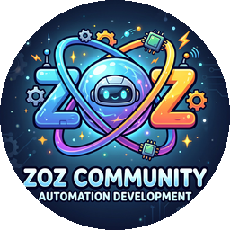
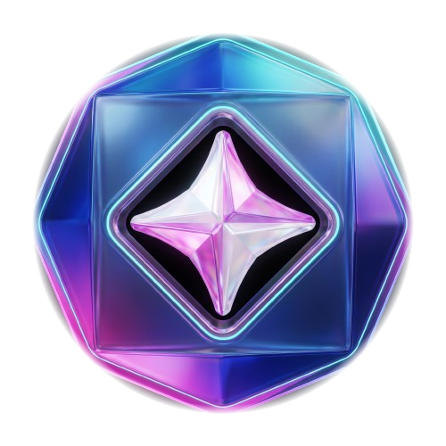
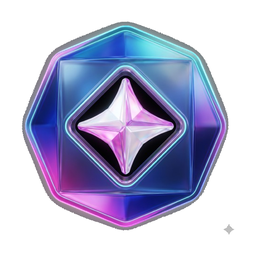
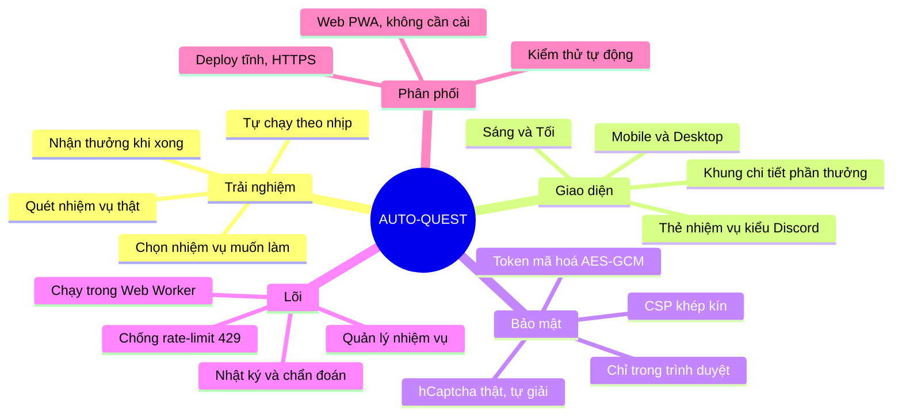
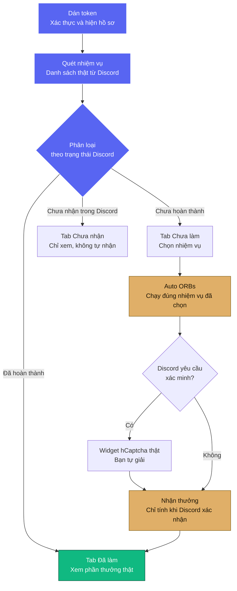
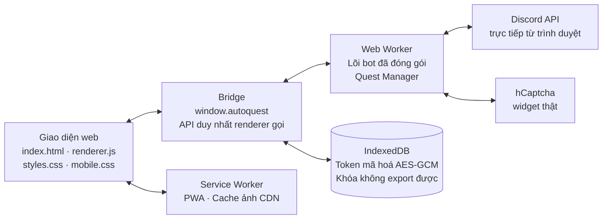

<div align="center">




# AUTO-QUEST

### Bảng điều khiển Discord Quests, thuần web — quét, chọn, cày và nhận thưởng, tất cả trong một nơi.


[](https://github.com/duyzoz/AUTO-QUEST/stargazers)
[](https://github.com/duyzoz/AUTO-QUEST/network/members)

**Không cần cài đặt. Không cần máy chủ trung gian. Mở trình duyệt là dùng được.**

> 🔮 **Quét nhiệm vụ thật từ Discord → chọn nhiệm vụ bạn muốn → cày đúng nhịp → nhận Orbs và phần thưởng thật.**

</div>

---

## 📑 Mục lục

- [🎮 AUTO-QUEST là gì](#-auto-quest-là-gì)
- [✨ Điểm nhấn](#-điểm-nhấn)
- [👀 Xem nhanh](#-xem-nhanh)
- [🗺️ Sơ đồ tư duy dự án](#-sơ-đồ-tư-duy-dự-án)
- [🔄 Luồng hoạt động](#-luồng-hoạt-động)
- [🏛️ Kiến trúc](#-kiến-trúc)
- [🚀 Bắt đầu nhanh](#-bắt-đầu-nhanh)
- [🔒 Bảo mật — nói thẳng, không phóng đại](#-bảo-mật--nói-thẳng-không-phóng-đại)
- [📜 Giấy phép & miễn trừ trách nhiệm](#-giấy-phép--miễn-trừ-trách-nhiệm)

---

## 🎮 AUTO-QUEST là gì

AUTO-QUEST là một ứng dụng web (PWA) giúp bạn quản lý toàn bộ hành trình
Discord Quests từ một màn hình duy nhất: xem danh sách nhiệm vụ thật từ
Discord, phân loại theo trạng thái, chọn những nhiệm vụ muốn làm, để ứng
dụng tự chạy chúng theo đúng nhịp, rồi nhận thưởng khi nhiệm vụ hoàn
thành — kể cả khi Discord yêu cầu xác minh bằng hCaptcha, bạn vẫn tự giải
bằng widget thật, không có đường vòng nào khác.

Mọi thứ chạy ngay trong trình duyệt của bạn. Token không đi qua máy chủ
của dự án, không đi qua proxy, không nằm trong bất kỳ cơ sở dữ liệu
chung nào.

---

## ✨ Điểm nhấn

| | Tính năng | Mô tả |
|---|---|---|
| 🔍 | **Quét trước, chạy sau** | Quét lấy danh sách thật từ Discord, xem rõ từng nhiệm vụ, rồi mới chọn và chạy. Không có nhiệm vụ nào tự chạy khi bạn chưa chọn. |
| 🚫 | **Không tự nhận nhiệm vụ** | Ứng dụng tuyệt đối không tự enroll. Nhiệm vụ ở trạng thái "Chưa nhận" chỉ hiển thị đúng trạng thái đó cho tới khi bạn nhận trong Discord. |
| 🎁 | **Phần thưởng hiển thị đúng** | Tab Đã làm hiện đúng phần thưởng thật: Orb hiện Orb, vật phẩm (avatar, hiệu ứng) hiện ảnh/video của chính phần thưởng đó, mã đổi thưởng hiện nhãn riêng. Ảnh hỏng sẽ rơi về logo game, không bao giờ rơi về Orb sai loại. |
| 📋 | **Chi tiết đầy đủ** | Bấm vào một nhiệm vụ đã làm để xem tên, game, loại thưởng, số Orb, ngày nhận và ảnh hero/logotype trong cùng một khung chi tiết. |
| 🔐 | **Mã đổi thưởng an toàn** | Mã (nếu Discord trả về) chỉ nằm trong bộ nhớ của phiên làm việc, hiện khi bạn bấm xem, không lưu vào localStorage, backup, log hay chẩn đoán. Nếu Discord không trả mã, khung chi tiết sẽ dẫn bạn tới trang quest trong Discord thay vì bịa ra một mã. |
| 🎨 | **Giao diện Sáng / Tối** | Hai theme hoàn chỉnh, ảnh nhiệm vụ tự chọn biến thể sáng hoặc tối phù hợp, đổi theme là vẽ lại ngay mà không cần quét lại. |
| 📱 | **Mobile hoàn chỉnh** | Drawer điều hướng, nút bấm đủ lớn, toolbar gọn với bộ lọc nâng cao thu gọn được — dùng tốt trên điện thoại, không chỉ trên desktop. |
| 📊 | **Nhật ký gọn, số liệu thật** | Số dư lấy từ ví thật của Discord. Số Orb đã nhận chỉ tính khi Discord xác nhận, không cộng ảo khi quét lại. |

---

## 👀 Xem nhanh

| | |
|---|---|
|  | **ZoZ Development** — logo dự án, dùng làm favicon bo tròn trên web. |
|  | **Discord Orbs** — phần thưởng thật khi hoàn thành nhiệm vụ, đổi được đồ trong Shop và credit Nitro. Logo Orbs thuộc bản quyền Discord Inc. |

> 📸 Ảnh chụp giao diện thật của ứng dụng sẽ được bổ sung vào mục này sau khi bản web mới deploy xong.

---

## 🗺️ Sơ đồ tư duy dự án



---

## 🔄 Luồng hoạt động



> [!IMPORTANT]
> **Nguyên tắc vàng:** ứng dụng không tự nhận nhiệm vụ và không tự nhận
> thưởng thay bạn khi bạn chưa ra lệnh. Mọi hành động quan trọng đều bắt
> đầu từ một thao tác rõ ràng của bạn.

---

## 🏛️ Kiến trúc



```
AUTO-QUEST/
├── web/                        # Toàn bộ ứng dụng thuần web
│   ├── app/                    # Giao diện (index.html, renderer.js, styles.css, mobile.css, sw.js)
│   │   └── assets/             # Logo ZoZ, logo Orb
│   ├── engine/                 # Lõi bot đã biên dịch cho Worker
│   ├── bridge.js               # window.autoquest — API duy nhất renderer gọi
│   ├── engine-worker.js        # Web Worker chạy bot
│   ├── engine-bundle.js        # Bundle lõi cho Worker
│   ├── build-engine.js         # Đóng gói engine
│   ├── build-static.js         # Xuất bản tĩnh sang web-dist/
│   └── server.js               # Server tĩnh local (127.0.0.1)
├── engine-src/                 # TypeScript gốc của bot
├── skills/ui-ux/               # Quy chuẩn giao diện (đọc trước khi sửa UI)
├── docs/                       # Hướng dẫn, phân tích, DEPLOY.md
├── .brain/                     # Nhật ký thay đổi theo ngày
└── web-dist/                   # (sinh ra khi build) bản deploy tĩnh
```

Quy chuẩn giao diện của dự án nằm ở
[`skills/ui-ux/SKILL-UI-UX.md`](skills/ui-ux/SKILL-UI-UX.md): token màu
duy nhất, thang spacing thống nhất, thang z-index cho drawer/modal,
toolbar gọn với bộ lọc nâng cao, và checklist kiểm tra ở 375px, 768px,
1024px, 1440px trên cả hai theme.

---

## 🚀 Bắt đầu nhanh

```bash
# Windows: nhấp đúp
web\start.bat

# Mọi hệ điều hành có Node.js 18+
npm start                 # = node web/server.js → http://127.0.0.1:4173
AQ_PORT=8080 npm start    # đổi cổng khi 4173 đang bận
```

Mở **http://127.0.0.1:4173** (không mở bằng `file://` — Service Worker và
Web Crypto cần nguồn HTTP(S)). Dán token Discord của bạn ở mục Cài Đặt,
bấm **Quét nhiệm vụ**, chọn nhiệm vụ rồi bấm **Auto ORBs**.

> [!WARNING]
> Token là thông tin nhạy cảm của riêng bạn. Chỉ dán vào ứng dụng này,
> không gửi cho bất kỳ ai, không dán vào trang web lạ. Ứng dụng không
> bao giờ gửi token của bạn tới máy chủ của dự án.

### Build, deploy và kiểm thử

```bash
npm run build:engine   # đóng gói lõi TypeScript → web/engine-bundle.js
npm run build:static   # xuất bản tĩnh deploy được → web-dist/
npm test               # self-test + mock claim + mock reward, không cần mạng, không cần token thật
npm run check:bundle   # kiểm tra bundle khớp với nguồn engine
npm run check:integrity # kiểm tra integrity.json khớp với file đã commit
```

| Lệnh | Tác dụng |
| --- | --- |
| `npm start` | Server tĩnh local, chỉ nghe `127.0.0.1` — không lộ ra mạng LAN. |
| `npm run build:engine` | Đóng gói `engine-src` + adapter thành bundle cho Web Worker. |
| `npm run build:static` | Copy toàn bộ app + adapter + font vào `web-dist/` để upload lên hosting tĩnh. |
| `npm test` | Chạy self-test: cấu trúc, CSP, ID, cú pháp, rà token rò rỉ. |

Deploy lên domain riêng: xem [`docs/DEPLOY.md`](docs/DEPLOY.md)
(Cloudflare Pages, Netlify, Nginx). Bắt buộc **HTTPS**; `web-dist/` là
document root, không cần backend — mọi request tới Discord và hCaptcha
đi thẳng từ trình duyệt của người dùng.

Bản desktop Electron 1.0.0 đã được lưu trữ; hướng đi hiện tại và duy
nhất là Web PWA 2.0.0.

---

## 🔒 Bảo mật — nói thẳng, không phóng đại

- **Token chỉ nằm trong trình duyệt:** IndexedDB, mã hoá AES-GCM 256,
  IV mới mỗi lần ghi, khoá thiết bị không export được. Không có nhánh
  rơi về lưu plaintext khi crypto bị chặn — khi đó phiên chỉ giữ trong
  RAM và hiện cảnh báo.
- **API không trả token:** `getConfig()` và danh sách tài khoản không
  bao giờ trả token thật. Muốn xem token phải có thao tác thật của
  người dùng qua cổng reveal có giới hạn.
- **CSP khép kín:** `script-src` không có `unsafe-inline` hay
  `unsafe-eval`; `connect-src` chốt theo tên host Discord và hCaptcha;
  `frame-ancestors 'none'`, `object-src 'none'`, `form-action 'none'`.
- **Giới hạn thật:** web thuần không bất khả xâm phạm — script chạy
  cùng origin (XSS) vẫn có thể giải mã nếu lấy được cả khoá lẫn bản
  mã. Lớp chắn thật là CSP khép kín và việc không còn điểm chèn
  HTML/CSS từ dữ liệu ngoài. Chi tiết đầy đủ: [`docs/DEPLOY.md`](docs/DEPLOY.md) §7.
- **Sao lưu mã hoá:** file sao lưu dùng PBKDF2 200.000 vòng, mật khẩu
  tối thiểu 12 ký tự cho bản xuất mới; bản sao lưu cũ vẫn mở được và
  file dùng KDF yếu sẽ được cảnh báo để xuất lại.

---

## 📜 Giấy phép & miễn trừ trách nhiệm

Phát hành theo **[MIT License](LICENSE)** — tự do dùng, sửa, chia sẻ,
kể cả thương mại, miễn giữ nguyên dòng bản quyền.

Bản quyền © 2026 **duyzoz / NgDuy (ZoZ Community)**.

> Đọc [`DISCLAIMER.md`](DISCLAIMER.md) trước khi dùng: dự án học tập,
> không liên kết chính thức với Discord Inc. Thương hiệu "Discord",
> logo và Orb thuộc bản quyền Discord Inc. Người dùng tự chịu trách
> nhiệm tuân thủ Điều khoản Dịch vụ của Discord.

---

## 🗒️ Nhật ký thay đổi

Nhật ký thay đổi theo ngày, bao gồm lịch sử phát triển đầy đủ của dự
án, nằm trong thư mục [`.brain/`](.brain/) — README này cố tình giữ gọn
để tập trung vào sản phẩm.

---

## ⭐ Star History

[](https://star-history.com/#duyzoz/AUTO-QUEST&Date)

> Nếu thấy dự án hữu ích, hãy để lại **1 ⭐** cho repo nhé — đó là động lực để ZoZ Development làm tiếp. 💚
