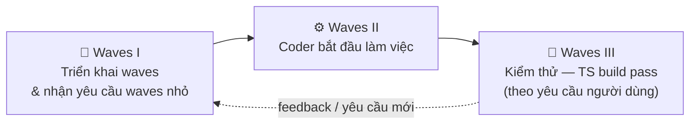
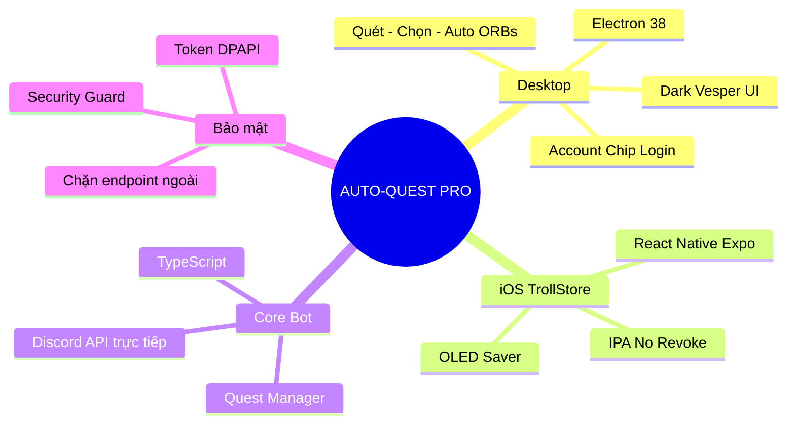
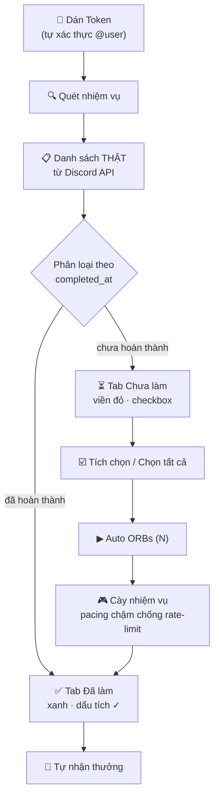
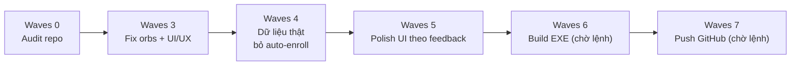

# ⚡ AUTO-QUEST PRO (Multiplatform Edition)

[](https://github.com/duyzoz/AUTO-QUEST/releases)
[](#)
[](#)
[](#-quy-tr%C3%ACnh-waves)

> ## 🤖 LƯU Ý CHO AI AGENT (BẮT BUỘC ĐỌC TRƯỚC KHI VIẾT/SỬA CODE)
> Trước khi viết hoặc sửa bất kỳ dòng code nào, agent **PHẢI đọc hết README này** (đặc biệt mục **Quy trình Waves** và **`---- Log AI Agent ----`** ở cuối) để nắm bối cảnh, quy ước và việc đang làm dở. Không đọc trước = làm lệch kiến trúc.
> Sau khi xong nhiệm vụ, agent **PHẢI ghi log 3–5 dòng** vào mục Log AI Agent + file `.brain/YYYY-MM-DD.txt` — ngắn gọn, tiết kiệm token.

---

## 🌊 Quy Trình Waves (BẮT BUỘC)

Mọi phiên làm việc đều chạy theo 3 giai đoạn cố định:



| Giai đoạn | Nội dung | Ai quyết định |
|---|---|---|
| **Waves I** | Triển khai waves, tiếp nhận yêu cầu waves nhỏ từ người dùng | Người dùng + Agent |
| **Waves II** | Bắt đầu làm việc (coder) — sửa code, UI/UX, logic | Agent |
| **Waves III** | Kiểm thử — `tsc` build pass, syntax check, smoke test | Agent (theo yêu cầu người dùng) |

**Quy tắc đánh số:**
- Agent **tự gán số waves từ `0` → `∞`** theo tiến độ thực tế.
- Người dùng **yêu cầu waves** → xác định số waves theo tiến độ hiện tại.
- Người dùng **không yêu cầu** → mặc định gán **waves mới cho từng phiên edit**.

---

## 🧠 Sơ Đồ Tư Duy Dự Án



## 🔄 Luồng Hoạt Động Chuẩn



> ⚠️ **Nguyên tắc vàng:** App **KHÔNG tự nhận nhiệm vụ** (không auto-enroll). Chỉ quét danh sách thật — người dùng tự nhận nhiệm vụ trong app Discord nếu muốn, sau đó tích chọn trong app và bấm **Auto ORBs**.

## 🗺️ Hướng Đi (Roadmap)



---

## 🎨 Tính Năng

| Tính năng | Mô tả |
|-----------|-------|
| **Dark Strong Vesper** | Nền OLED `#000000`, bề mặt than/nâu `#100d14`, điểm nhấn hổ phách `#ff9e64`. |
| **Account Chip Login** | Dán token → tự xác thực `discord.com/api` → hiện `@username` + avatar thật từ Discord CDN. |
| **Quét trước — Chạy sau** | **Quét nhiệm vụ** lấy danh sách thật → tab "⏳ Chưa làm" (viền đỏ, checkbox từng nhiệm vụ + **Chọn tất cả**) → **Auto ORBs (N)** chạy đúng nhiệm vụ đã chọn. |
| **Không tự nhận nhiệm vụ** | App tuyệt đối không auto-enroll. Nhiệm vụ "Chưa nhận" hiển thị đúng trạng thái Discord, checkbox khoá cho tới khi bạn nhận trong app Discord. |
| **Số liệu chuẩn 100%** | "Đã làm" chỉ chứa nhiệm vụ Discord xác nhận `completed_at`; "Chưa làm" chỉ chứa nhiệm vụ còn hiệu lực (đã bắt đầu, chưa hết hạn, không preview). |
| **Orbs chuẩn** | Mỗi nhiệm vụ cộng Orbs đúng **một lần** (dedupe theo quest id), không cộng ảo khi quét lại. |
| **Bảo mật 100%** | Chỉ kết nối `discord.com` — chặn đứng mọi webhook/endpoint ngoài. Token mã hóa Windows DPAPI. |
| **Treo AFK Loop** | Tự đếm ngược chu kỳ 15/30/45/60 phút để quét lại nhiệm vụ mới. |
| **🌙 OLED Saver (iOS)** | Giữ app hoạt động qua đêm với 0% hao pin. |

---

## 📥 TẢI VỀ CÀI ĐẶT

### 🖥️ Windows Desktop
- Vào **[Releases](https://github.com/duyzoz/AUTO-QUEST/releases)** → tải **`AUTO-QUEST.exe`**.
- Mở file, dán token, bấm **Quét nhiệm vụ** → chọn → **Auto ORBs**.

### 📱 iPhone (TrollStore)
- Tải **`AUTO-QUEST-PRO-TrollStore.ipa`** từ Releases/Actions.
- Mở bằng **TrollStore** → **Install** (chạy vĩnh viễn, không hết hạn chứng chỉ).

---

## 🔑 HƯỚNG DẪN LẤY TOKEN DISCORD

### Cách 1: Máy tính (Console)
1. Mở Discord (Web/App), bấm `F12` → tab **Console**.
2. Nếu Discord chặn dán: gõ `allow pasting` rồi Enter.
3. Dán đoạn mã sau rồi Enter:

```javascript
window.webpackChunkdiscord_app.push([
	[Symbol()],
	{},
	req => {
		if (!req.c) return;
		for (let m of Object.values(req.c)) {
			try {
				if (!m.exports || m.exports === window) continue;
				if (m.exports?.getToken) return copy(m.exports.getToken());
				for (let ex in m.exports) {
					if (m.exports?.[ex]?.getToken && m.exports[ex][Symbol.toStringTag] !== 'IntlMessagesProxy') return copy(m.exports[ex].getToken());
				}
			} catch {}
		}
	},
]);
window.webpackChunkdiscord_app.pop();
console.log('%c🎉 ĐÃ COPY TOKEN DISCORD THÀNH CÔNG! 🎉', 'color: #10b981; font-size: 22px; font-weight: bold; background: #000; padding: 10px; border-radius: 8px;');
```

4. Quay lại app bấm **Dán** → chip góc phải tự hiện `@username` → **Lưu**.

### Cách 2: iPhone (Safari)
1. Safari → `discord.com/app`, đăng nhập.
2. Trong app bấm **COPY SCRIPT LẤY TOKEN**.
3. Thanh địa chỉ Safari: gõ `javascript:` rồi dán script, Enter.
4. Quay lại app bấm **Dán** → **Lưu Token**.

---

## 📁 Cấu Trúc Repo

```
AUTO-QUEST-main/
├── bot.ts                  # Entry point bot (compile → electron/bot/)
├── src/                    # Core logic TypeScript
│   ├── client.ts           # Discord REST + Gateway
│   ├── questManager.ts     # Quản lý & thực thi nhiệm vụ
│   ├── security.ts         # Chặn endpoint ngoài
│   └── ...
├── electron/               # Desktop app
│   ├── main.js             # Main process + IPC
│   ├── preload.js          # Bridge an toàn
│   └── renderer/           # UI (index.html, renderer.js, styles.css)
├── mobile/                 # iOS (React Native) — KHÔNG ĐỤNG
├── build-release/          # Script build/release (IPA, desktop)
├── docs/                   # Hướng dẫn sử dụng
├── .brain/                 # Log AI Agent theo ngày (YYYY-MM-DD.txt)
└── README.md
```

---

## 🧪 Dev Mode (xem giao diện trước khi build)

```bash
npm install        # lần đầu
npm run dev        # build bot TS + mở Electron
```

Chỉ build EXE khi có lệnh: `npm run build`.

---

## 📜 Giấy phép & Miễn trừ trách nhiệm
Dự án phục vụ mục đích học tập và tối ưu trải nghiệm cá nhân. Không liên kết chính thức với Discord Inc.

---

## ---- Log AI Agent ----

> Agent đọc mục này **TRƯỚC** khi code. Ghi log ngắn gọn (3–5 dòng) sau mỗi đợt làm việc. Log chi tiết theo ngày nằm trong `.brain/`.

- **[2026-10-19 ~19:45 · GLM (Z.ai) · Waves 4 — Dữ liệu thật + bỏ auto-enroll]** Xoá `redeemPending` khỏi luồng quét/scan: quét xong dừng ngay, **không tự nhận/đăng ký nhiệm vụ**. Inventory lọc `preview` + chỉ giữ quest thật; thêm cờ `automatable` (STREAM/loại lạ = làm thủ công). UI: bỏ nút Auto ORBs trùng lặp trong tab, chỉ còn 1 nút; checkbox khoá với quest "Chưa nhận". **Đang dở:** chờ user chạy `npm run dev` xem UI; chưa build EXE, chưa push (chờ lệnh).
- **[2026-10-19 ~19:00 · GLM (Z.ai) · Waves 3]** Fix orbs cộng ảo (dedupe quest id, bỏ fallback 300), event `quest:inventory`/`scan:complete`/`quest:redeem` + id cho mọi event; bot tách MODE `scan`/`run`/`full` + pacing chống rate-limit; UI account chip login, tab "Chưa làm" viền đỏ + checkbox + Chọn tất cả + Auto ORBs(N); dọn repo `build-ipa/` → `build-release/`, docs → `docs/`.
- **[2026-10-19 ~18:30 · GLM (Z.ai) · Waves 0 — Audit]** Đọc toàn bộ repo, lập danh sách 13 lỗi UI/UX + logic, đề xuất roadmap waves.
